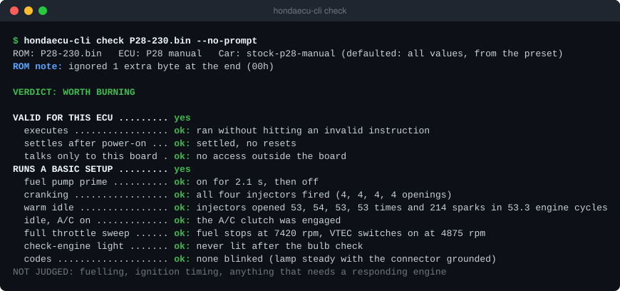
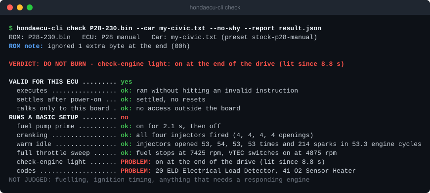
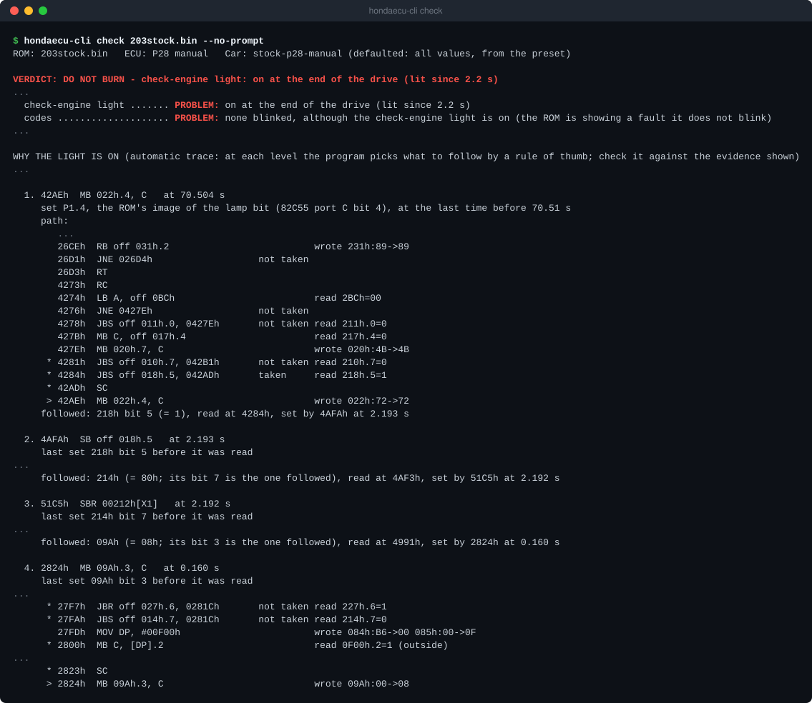
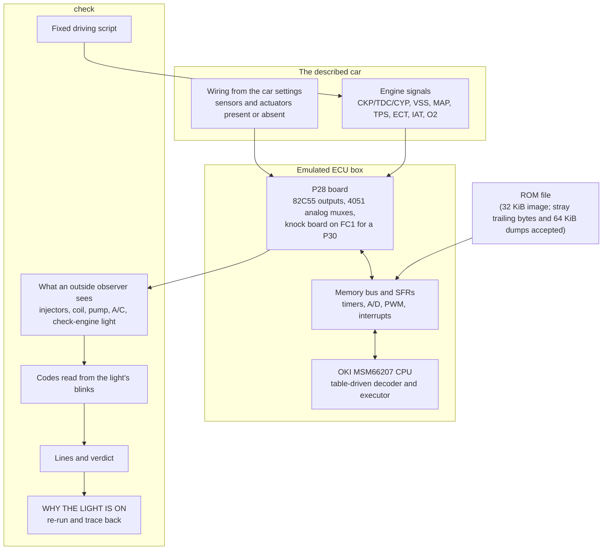

# hondaecu-cli

[](LICENSE)
[](https://github.com/VIRUXE/hondaecu-cli/releases/latest)

Find out whether a ROM will run on a Honda OBD1 P28 or P30 ECU before you
burn a chip. `hondaecu-cli` emulates the ECU's OKI MSM66207 processor and its
board, wires it to the car you describe, drives it through a short scripted
run, and tells you what an observer outside the box would see: does it boot,
does it fire the injectors and the coil, does the check-engine light come on,
and which codes it blinks.

It is for tuners and people who swap ECUs, to catch a bad ROM on the computer
instead of after burning a chip and turning the key. It does not judge
fuelling, ignition timing or how good a tune is: it tells you whether, on the
modelled box and car, the ROM boots, runs the engine's outputs and keeps the
check-engine light off, and when the light stays on, where in the ROM it was
switched on.







The three pictures are real runs. The text is below, so you can read and copy
it. A line holding only `...` marks output cut for the picture; the indented
`...` lines inside a trace are the tool's own.

---

## Contents

- [What a run looks like](#what-a-run-looks-like)
- [What it said about 185 real ROMs](#what-it-said-about-185-real-roms)
- [Quick start](#quick-start)
- [Describing the car](#describing-the-car)
- [Reading a report](#reading-a-report)
- [What it does not tell you](#what-it-does-not-tell-you)
- [Other commands](#other-commands)
- [Building and testing](#building-and-testing)
- [How the emulator is built](#how-the-emulator-is-built)
- [Fault code names](#fault-code-names)
- [Project layout](#project-layout)
- [Documentation](#documentation)
- [License](#license)

---

## What a run looks like

**A stock ROM that passes.** This P28-230 dump has one stray byte after the
32 KiB image; the tool says so and carries on.

```text
$ hondaecu-cli check P28-230.bin --no-prompt
ROM: P28-230.bin   ECU: P28 manual   Car: stock-p28-manual (defaulted: all values, from the preset)
ROM note: ignored 1 extra byte at the end (00h)

VERDICT: WORTH BURNING

VALID FOR THIS ECU ......... yes
  executes ................. ok: ran without hitting an invalid instruction
  settles after power-on ... ok: settled, no resets
  talks only to this board . ok: no access outside the board
RUNS A BASIC SETUP ......... yes
  fuel pump prime .......... ok: on for 2.1 s, then off
  cranking ................. ok: all four injectors fired (4, 4, 4, 4 openings)
  warm idle ................ ok: injectors opened 53, 54, 53, 53 times and 214 sparks in 53.3 engine cycles
  idle, A/C on ............. ok: the A/C clutch was engaged
  full throttle sweep ...... ok: fuel stops at 7420 rpm, VTEC switches on at 4875 rpm
  check-engine light ....... ok: never lit after the bulb check
  codes .................... ok: none blinked (lamp steady with the connector grounded)
NOT JUDGED: fuelling, ignition timing, anything that needs a responding engine
```

**The same ROM in a car that does not match it.** `my-civic.txt` describes a
car with no electrical load detector (`eld = no`), a one-wire oxygen sensor
with no heater (`o2_sensor = one-wire`) and no A/C. The stock ROM expects both
sensors, so it stores codes 20 and 41 and the light stays on. The codes are
read from the light's blinks, the way you would read them in the car.

```text
$ hondaecu-cli check P28-230.bin --car my-civic.txt --no-why --report result.json
ROM: P28-230.bin   ECU: P28 manual   Car: my-civic.txt (preset stock-p28-manual)
ROM note: ignored 1 extra byte at the end (00h)

VERDICT: DO NOT BURN - check-engine light: on at the end of the drive (lit since 8.8 s)

VALID FOR THIS ECU ......... yes
  executes ................. ok: ran without hitting an invalid instruction
  settles after power-on ... ok: settled, no resets
  talks only to this board . ok: no access outside the board
RUNS A BASIC SETUP ......... no
  fuel pump prime .......... ok: on for 2.1 s, then off
  cranking ................. ok: all four injectors fired (4, 4, 4, 4 openings)
  warm idle ................ ok: injectors opened 53, 54, 53, 53 times and 214 sparks in 53.3 engine cycles
  full throttle sweep ...... ok: fuel stops at 7425 rpm, VTEC switches on at 4875 rpm
  check-engine light ....... PROBLEM: on at the end of the drive (lit since 8.8 s)
  codes .................... PROBLEM: 20 ELD Electrical Load Detector, 41 O2 Sensor Heater
NOT JUDGED: fuelling, ignition timing, anything that needs a responding engine
```

**A solid light with no code.** The stock P30 ROM (`203stock.bin`, mask 203)
in a P28 box. Its knock control is on, and a P28 box has no knock board, so
the ROM stores a fault it never blinks: the light stays on, and with the
service connector grounded it shows what looks like "no codes". This is the
case where you need to know *where it stops*, so the report ends with
`WHY THE LIGHT IS ON`: it re-runs the drive and walks back from the
instruction that lit the lamp to the check that tripped. Here it ends at the
knock board's heartbeat input on connector FC1:

```text
     stopped: the path reads an input: 0F00h bit 2 (= 1), read at 2800h, from outside the CPU: 82C55 port A bit 2, knock-board heartbeat on connector FC1 (pull-up only with no knock board).
```

The same ROM on a P30 box (`--ecu p30`) is worth burning.

<details>
<summary>The whole report, with the trace (127 lines)</summary>

```text
$ hondaecu-cli check 203stock.bin --no-prompt
ROM: 203stock.bin   ECU: P28 manual   Car: stock-p28-manual (defaulted: all values, from the preset)

VERDICT: DO NOT BURN - check-engine light: on at the end of the drive (lit since 2.2 s)

VALID FOR THIS ECU ......... yes
  executes ................. ok: ran without hitting an invalid instruction
  settles after power-on ... ok: settled, no resets
  talks only to this board . ok: no access outside the board
RUNS A BASIC SETUP ......... no
  fuel pump prime .......... ok: on for 2.1 s, then off
  cranking ................. ok: all four injectors fired (4, 4, 4, 4 openings)
  warm idle ................ ok: injectors opened 53, 54, 53, 53 times and 213 sparks in 53.3 engine cycles
  idle, A/C on ............. ok: the A/C clutch was engaged
  full throttle sweep ...... ok: fuel stops at 8310 rpm, VTEC switches on at 5690 rpm
  check-engine light ....... PROBLEM: on at the end of the drive (lit since 2.2 s)
  codes .................... PROBLEM: none blinked, although the check-engine light is on (the ROM is showing a fault it does not blink)
NOT JUDGED: fuelling, ignition timing, anything that needs a responding engine

WHY THE LIGHT IS ON (automatic trace: at each level the program picks what to follow by a rule of thumb; check it against the evidence shown)
  Starts from the last instruction before 70.51 s, when the lit span that lasts to the end of the drive ends, that set P1.4, the ROM's image of the lamp bit (82C55 port C bit 4).
  Each level: the instruction, the path into it (> marks it, * the instructions it depends on), what was followed next.
  What is followed: among the data the starred instructions read, data written by another routine before the
  routine's own bookkeeping, the read nearest the instruction first; a choice that ends without reaching an
  input or a ROM constant is given up for the next. The trace stops at an input from outside the CPU.
  Addresses in reads and writes are resolved (off 018h is 218h when LRB points at page 2).

  1. 42AEh  MB 022h.4, C   at 70.504 s
     set P1.4, the ROM's image of the lamp bit (82C55 port C bit 4), at the last time before 70.51 s
     path:
        ...
        26CEh  RB off 031h.2                          wrote 231h:89->89
        26D1h  JNE 026D4h                   not taken
        26D3h  RT
        4273h  RC
        4274h  LB A, off 0BCh                         read 2BCh=00
        4276h  JNE 0427Eh                   not taken
        4278h  JBS off 011h.0, 0427Eh       not taken read 211h.0=0
        427Bh  MB C, off 017h.4                       read 217h.4=0
        427Eh  MB 020h.7, C                           wrote 020h:4B->4B
      * 4281h  JBS off 010h.7, 042B1h       not taken read 210h.7=0
      * 4284h  JBS off 018h.5, 042ADh       taken     read 218h.5=1
      * 42ADh  SC
      > 42AEh  MB 022h.4, C                           wrote 022h:72->72
     followed: 218h bit 5 (= 1), read at 4284h, set by 4AFAh at 2.193 s

  2. 4AFAh  SB off 018h.5   at 2.193 s
     last set 218h bit 5 before it was read
     path:
        ...
        4AE3h  J 05FDBh
        5FDBh  L A, off 012h                          read 212h=00 213h=00
        5FDDh  OR A, off 014h                         read 214h=80 215h=00
        5FDFh  J 04AE6h
        4AE6h  ADD A, #0FFFFh
        4AE9h  MB off 018h.6, C                       wrote 218h:00->40
      * 4AECh  L A, off 012h                          read 212h=00 213h=00
      * 4AEEh  AND A, #0FFFDh
      * 4AF1h  JNE 04AFAh                   not taken
      * 4AF3h  L A, off 014h                          read 214h=80 215h=00
      * 4AF5h  AND A, #014F5h
      * 4AF8h  JEQ 04AFDh                   not taken
      > 4AFAh  SB off 018h.5                          wrote 218h:40->60
     followed: 214h (= 80h), read whole at 4AF3h; the last of its bits to change was bit 7, 1 at that read, set by 51C5h at 2.192 s

  3. 51C5h  SBR 00212h[X1]   at 2.192 s
     last set 214h bit 7 before it was read
     path:
        ...
      * 4A45h  SUBB A, r7                             read 20Fh=14
      * 4A46h  JNE 04A96h                   not taken
        ...
      * 4A50h  LB A, r7                               read 20Fh=14
      * 4A51h  CMPB A, #030h
      * 4A53h  JNE 04A62h                   taken
      * 4A62h  LCB A, 06C99h[006h]                    read ROM 6CADh=18
      * 4A67h  JEQ 04A92h                   not taken
        4A69h  STB A, r6                              wrote 20Eh:EE->18
        4A6Ah  SB off 030h.0                          wrote 230h:0C->0D
        4A6Dh  SB off 030h.1                          wrote 230h:0D->0F
        4A70h  J 0594Ah
        594Ah  CAL 051B9h                             wrote 47Eh:8E->4D 47Fh:49->59
      * 51B9h  SUBB A, #001h
      * 51BBh  MOVB r0, #008h                         wrote 208h:00->08
      * 51BDh  DIVB                                   read 208h=08 wrote 209h:00->07
        51BFh  MOV X1, A                              wrote 080h:CD->02 081h:6C->00
      * 51C0h  LB A, r1                               read 209h=07
        51C1h  SBR 00112h[X1]                         wrote 114h:00->80
      > 51C5h  SBR 00212h[X1]                         wrote 214h:00->80
     followed: 09Ah (= 08h), read whole at 4991h; the last of its bits to change was bit 3, 1 at that read, set by 2824h at 0.160 s
     also read:
       - ROM 6CADh (= 18h), read at 4A62h, a constant in the ROM
       - 0EAh (= 14h), read at 4A3Ch, set by 4A41h at 1.680 s
       - 2C1h (= 00h), read at 49CAh, set by 4A3Bh at 1.680 s, then counted on by itself (last at 5210h, 2.188 s)
       - 2A7h (= 14h), read at 49C3h, set by 49D1h at 0.166 s

  4. 2824h  MB 09Ah.3, C   at 0.160 s
     last set 09Ah bit 3 before it was read
     path:
        ...
      * 520Eh  JEQ 05214h                   taken
        ...
      * 521Bh  JRNZ DP, 05204h              taken     wrote 084h:04->03 085h:00->00
        ...
      * 521Bh  JRNZ DP, 05204h              taken     wrote 084h:03->02 085h:00->00
        ...
      * 520Bh  LB A, 00000h[X1]                       read 2E8h=01
      * 520Eh  JEQ 05214h                   not taken
      * 5210h  DECB 00000h[X1]                        read 2E8h=01 wrote 2E8h:01->00
        ...
      * 27F7h  JBR off 027h.6, 0281Ch       not taken read 227h.6=1
      * 27FAh  JBS off 014h.7, 0281Ch       not taken read 214h.7=0
        27FDh  MOV DP, #00F00h                        wrote 084h:B6->00 085h:00->0F
      * 2800h  MB C, [DP].2                           read 0F00h.2=1 (outside)
      * 2802h  RB off 032h.6                          wrote 232h:40->00
        2805h  MB off 032h.6, C                       wrote 232h:00->40
      * 2808h  JEQ 0280Dh                   not taken
      * 280Ah  XORB PSWH, #080h
      * 280Dh  JGE 0281Fh                   taken
      * 281Fh  LB A, off 0E8h                         read 2E8h=00
      * 2821h  JNE 0281Ch                   not taken
      * 2823h  SC
      > 2824h  MB 09Ah.3, C                           wrote 09Ah:00->08
     also read:
       - 227h bit 6 (= 1), read at 27F7h, set by 556Eh at 0.038 s
       - 2E8h (= 01h), read at 5210h, set by 2818h at 0.057 s, then counted on by itself (last at 5210h, 0.149 s)
       - 0CEh (= 05h), read at 268Ch, set by 2692h at 0.149 s, then counted on by itself (last at 0142h, 0.159 s)
     stopped: the path reads an input: 0F00h bit 2 (= 1), read at 2800h, from outside the CPU: 82C55 port A bit 2, knock-board heartbeat on connector FC1 (pull-up only with no knock board).
```

</details>

---

## What it said about 185 real ROMs

Every file of 32 KiB (or one byte more) in the
[hondabase files archive](https://github.com/hondabase/files-archive), 185
files of stock images, Crome, Honda Tuning Suite and TurboEdit tunes, and a
few files that are not ECU code at all, was run through `check --no-prompt
--no-why`, once on a P28 box and once on a P30 box, each with that box's
stock car. Run on 2026-11-14.

| verdict | P28 box | P30 box |
|---|---|---|
| `WORTH BURNING` | 87 | 100 |
| `DO NOT BURN` | 98 | 85 |
| `COULD NOT TELL` | 0 | 0 |
| refused (not a ROM image) | 0 | 0 |

By folder, worth burning:

| folder | files | P28 box | P30 box |
|---|---|---|---|
| `ecu-roms/` (stock images, many ECU families) | 101 | 33 | 45 |
| `xenocron/crome/` (Crome tunes) | 48 | 45 | 46 |
| `hts/bins/` (Honda Tuning Suite tunes) | 8 | 8 | 8 |
| `xenocron/hondata/`, `xenocron/bre/` | 4 | 1 | 1 |
| `xenocron/turboedit/` (OBD0 tunes) | 21 | 0 | 0 |
| `haltech/` (Haltech base maps, not ECU code) | 3 | 0 | 0 |

A run took about 50 seconds (median; the slowest 88 s), ten at a time on a
desktop PC.

What it caught, among others:

- **ROMs for another processor, stopped at once.** All 21 TurboEdit tunes
  are OBD0 code. They, 23 stock images for other ECUs and the three Haltech
  files stop on their first instructions:
  `executes: undefined opcode ... at 0.0 s`.
- **ROMs for other ECU boards.** 26 stock images with other part numbers
  (P12, P13, P14, PR3, PR4, PT6, PW0 and more) and two BRE tunes run but
  never settle on a P28 box: `never settles: 28572 resets in the first
  second`, or the watchdog goes unserved at 0.5 s.
- **ROMs that need a knock board.** 13 ROMs, the stock P30 and P72 among
  them, light the lamp 2.2 s after key-on and blink nothing on a P28 box, and
  are worth burning on a P30 box. For the stock P30 and P72 the cause is
  traced: knock control is on, and a P28 box has no knock board (the
  `WHY THE LIGHT IS ON` example above); the other 11 show the same pattern.
- **Base images that keep resetting.** `332stock.bin` and `P61-USDM-215.bin`
  reset every 5.3 s on both boxes. Their bytes sum to FFh, not 0: the
  pattern of the ERM baseline, whose own checksum was traced as the cause
  (`docs/CHECK.md`, "ERM baseline: its own checksum"). These two were not
  traced.
- **ROMs that never set up the board.** Three, two of them Crome tunes, never
  program the board's 82C55 interface chip, which drives the fuel pump and
  the lamp: `the board was never programmed`.
- **Messy dumps.** Four stock images with a stray byte after the 32 KiB were
  refused by earlier versions; they are now read with a `ROM note:` and are
  worth burning on both boxes.
- **Displays that are not faults.** Many Crome and Honda Tuning Suite tunes
  flash the lamp at key-on or use it as a shift light. The lamp goes out
  again and the read-out shows no code, so they pass, with a line such as
  `ok: off at the end of the drive; it lit once during key on and once during
  full throttle (a start-up flash or a shift light looks like this)`.

And the stock P28 ROM on cars that do not match it, one setting changed at a
time (`docs/CHECK.md`, "The car values, one by one"): no speed sensor gives
code 17, no idle valve code 14, no ELD code 20, a one-wire oxygen sensor code
41, a manual car on an automatic board code 19, each read from the blinks.

How results like these were traced back to the ROM, image by image, is in
[`docs/CHECK.md`](docs/CHECK.md), "Results on the images at hand" and "The
three do-not-burn results, traced".

---

## Quick start

### Get the program

Download the file for your computer from the
[latest release](https://github.com/VIRUXE/hondaecu-cli/releases/latest) and
unpack it anywhere. There is nothing to install: it is one program file that
needs nothing else.

| Computer | File to download |
|---|---|
| Windows, 64-bit | `hondaecu-cli-v…-windows-x86_64.zip` |
| Linux, x86-64 | `hondaecu-cli-v…-linux-x86_64.tar.gz` |
| Mac with Apple silicon | `hondaecu-cli-v…-macos-arm64.tar.gz` |

It is a command-line program, so it runs in a terminal, not by
double-clicking:

- **Windows:** unzip, open the unzipped folder, right-click an empty spot and
  choose **Open in Terminal**. The program is `.\hondaecu-cli.exe`.
- **Linux and Mac:** unpack with `tar -xzf <file>`, `cd` into the folder it
  made. The program is `./hondaecu-cli`.

The program is not code-signed. If Windows shows "Windows protected your PC",
choose **More info**, then **Run anyway**. If macOS refuses to open it, run
`xattr -d com.apple.quarantine ./hondaecu-cli` once.

`hondaecu-cli --version` prints which version you have. For any other
computer, or to work on the code, see
[Building and testing](#building-and-testing).

### Check a ROM

```bash
hondaecu-cli check my-rom.bin
```

Run in a terminal, it asks about the car first (see below), then runs. `test`
is another name for `check`. On Windows that is
`.\hondaecu-cli.exe check my-rom.bin`, on Linux and Mac
`./hondaecu-cli check my-rom.bin`, from the folder the program is in. Give the
ROM's full path if it is somewhere else; dragging the file onto the terminal
window types its path for you.

A run takes about half a minute to a minute. When the light stays on, the
`WHY THE LIGHT IS ON` trace re-runs the drive and adds about another minute;
`--no-why` skips it.

The full option list (`check --help`):

```text
$ hondaecu-cli check --help
Usage: hondaecu-cli check <rom.bin> [options]
  --ecu p28|p30                      ECU model (shorthand for --set ecu=...)
  --board-gearbox manual|automatic   gearbox the board is set up for (shorthand for --set board_gearbox=...)
  --car <preset|file>                start from a preset (stock-p28-manual, stock-p28-automatic, stock-p30) or a car file
  --set key=value                    set one car value; may be repeated
  --report <file>                    also write the result as JSON
  --no-prompt                        never ask questions; anything not given takes its default
  --no-why                           skip the trace of why the check-engine light is on
Exit status: 0 worth burning, 1 do not burn, 2 bad command line or unreadable file, 3 could not tell.
```

### What the run does

The ROM runs on a model of the ECU box (a P28 board, plus a knock board on
connector FC1 for a P30), wired to your car, through one fixed script of
about 110 seconds of ECU time:

| stage | seconds | rpm | MAP kPa | throttle % | km/h |
|---|---|---|---|---|---|
| key on | 6 | 0 | 100 | 0 | 0 |
| cranking | 1.5 | 300 | 90 | 0 | 0 |
| cold idle (coolant 0 C) | 3 | 1500 | 45 | 0 | 0 |
| warm idle | 8 | 800 | 35 | 0 | 0 |
| idle, A/C on (only with `ac = yes`) | 4 | 800 | 40 | 0 | 0 |
| cruise | 4 | 2500 | 45 | 15 | 60 |
| full throttle | 14 | 2000 to 9000 | 98 | 100 | 100 |
| lift off | 22 | 6000 to 1500 | 25 | 0 | 80 |
| warm idle again | 8 | 800 | 35 | 0 | 0 |
| code read-out (service connector grounded) | 40 to 180 | 800 | 35 | 0 | 0 |

Coolant is 88 C everywhere except cold idle. The code read-out runs until the
blinked codes have repeated, so a ROM with many codes takes longer.

---

## Describing the car

The same ROM can be fine in one car and light the lamp in another, so `check`
needs to know what is wired to the ECU. A car is twelve settings:

| setting | answers | meaning |
|---|---|---|
| `ecu` | `p28`, `p30` | ECU box (a P30 box has the knock board) |
| `board_gearbox` | `manual`, `automatic` | gearbox the ECU board is set up for |
| `gearbox` | `manual`, `automatic` | gearbox in the car |
| `vtec` | `yes`, `no` | VTEC engine |
| `knock_sensor` | `yes`, `no` | knock sensor fitted |
| `o2_sensor` | `none`, `one-wire`, `heated` | oxygen sensor |
| `iacv` | `stock`, `none`, or a resistance in ohms | idle air control valve |
| `egr` | `yes`, `no` | EGR valve lift sensor fitted |
| `eld` | `yes`, `no` | electrical load detector fitted |
| `speed_sensor` | `yes`, `no` | vehicle speed sensor connected |
| `ac` | `yes`, `no` | air conditioning fitted |
| `power_steering_switch` | `yes`, `no` | power steering pressure switch fitted |

There are three presets:

| preset | `ecu` | gearbox | `knock_sensor` | everything else |
|---|---|---|---|---|
| `stock-p28-manual` | p28 | manual | no | `vtec = yes`, `o2_sensor = heated`, `iacv = stock`, `egr = no`, `eld = yes`, `speed_sensor = yes`, `ac = yes`, `power_steering_switch = yes` |
| `stock-p28-automatic` | p28 | automatic | no | the same |
| `stock-p30` | p30 | manual | yes | the same |

Three ways to give the settings, which can be mixed (a later one wins):

1. **A preset or a car file**: `--car stock-p30`, or `--car my-civic.txt`.
   A car file is `key = value` lines, `#` starts a comment, and it may start
   with `preset = <name>`. For example, the `my-civic.txt` used above:

   ```text
   preset = stock-p28-manual
   ecu = p28
   board_gearbox = manual
   gearbox = manual
   vtec = yes
   knock_sensor = no
   o2_sensor = one-wire
   iacv = stock
   egr = no
   eld = no
   speed_sensor = yes
   ac = no
   power_steering_switch = yes
   ```

2. **Flags**: `--set key=value` (repeat it), and the shorthands `--ecu` and
   `--board-gearbox`:

   ```bash
   hondaecu-cli check my-rom.bin --ecu p30
   hondaecu-cli check my-rom.bin --car stock-p28-automatic --set knock_sensor=no
   hondaecu-cli check my-rom.bin --set iacv=none --set eld=no --no-prompt
   ```

3. **Questions**: in a terminal, without `--no-prompt`, `check` asks which
   preset to start from and then every setting you have not given, for
   example `Knock sensor fitted? (yes/no) [no]:`. Enter takes the default in
   brackets. At the end it offers to save your answers to a car file, so the
   next run can use `--car`.

With no preset named, `ecu = p30` (from any of these) starts from
`stock-p30`, otherwise from `stock-p28-manual`. Anything you did not give is
listed in the report's first line as `defaulted`.

---

## Reading a report

### The verdict

| verdict | exit status | meaning |
|---|---|---|
| `WORTH BURNING` | 0 | every line is ok |
| `DO NOT BURN` | 1 | at least one line is a problem; the verdict names the first |
| `COULD NOT TELL` | 3 | nothing is wrong, but at least one line could not be judged; the verdict names the first |

Exit status 2 means the command line was wrong, the ROM or car file could not
be read or is not a ROM image, or the `--report` file could not be written.
The exit status makes `check` easy to use in a script or a batch of ROMs.

### The lines

Every line says its state before what was seen:

- `ok:` the thing was seen to work (an ok always comes from something the
  ROM was seen to do, never from the absence of a bad sign);
- `PROBLEM:` something was seen to go wrong;
- `could not tell:` it could not be judged, for example because the run
  stopped earlier.

The lines, in order:

| line | what it looks at |
|---|---|
| executes | the ROM ran to the end without an invalid instruction |
| settles after power-on | it stopped resetting within a second and did not reset later |
| talks only to this board | it did not read or write addresses the board does not have |
| car as described | only present when a setting is not modelled (see below); always "could not tell" |
| fuel pump prime | the pump ran for 0.5 to 5 s at key-on and then stopped |
| cranking | every injector opened while cranking |
| warm idle | each injector opened once per engine cycle and the coil fired |
| idle, A/C on | the A/C clutch engaged (only with `ac = yes`) |
| full throttle sweep | injectors opened; where fuel stopped and where VTEC switched on |
| check-engine light | the lamp did its bulb check at key-on and is off at the end of the drive |
| codes | the codes blinked with the service connector grounded, with their names |

Two things the light lines take care of: a lamp that lights and goes out
again (a start-up flash, a shift light) is reported but is not a problem; and
a ROM whose lamp never lights at key-on cannot show a fault, so it is never
worth burning. The exact rule for every line is in
[`docs/CHECK.md`](docs/CHECK.md), "The lines".

### The `ROM note:` line

Real dumps are not always 32768 clean bytes. `check` reads:

| file size | what is used |
|---|---|
| 32768 bytes | all of it |
| 32769 to 65535 bytes | the first 32768; the rest is ignored (a stray byte, a text note) |
| 65536 bytes (a 32 KiB ROM on a 27C512) | either half if both are the same, else the half that is not blank; two different halves are refused |
| anything else | refused, exit status 2 |

Whenever bytes were ignored or a half was chosen, a `ROM note:` line under
the first line says so, for example
`ROM note: ignored 1 extra byte at the end (FFh)`. The other commands print
the same note once on standard error.

### Why the light is on

When the light is on at the end of the drive, the report ends with
`WHY THE LIGHT IS ON`. It starts from the instruction that set the lamp bit
and, level by level, follows the data that decided it, back to an input from
outside the processor (a sensor, a connector pin) or a constant in the ROM.
Each level shows the instruction, its address and time, the instructions
before it (`*` marks the ones it depends on), the values read and written, and
what it followed next. It is an automatic trace: at each level a rule of
thumb picks what to follow, and it says so. It never changes the verdict or
the exit status. `--no-why` skips it.

### JSON

`--report result.json` also writes the result as JSON: the ROM, the
`rom_note`, the car settings and which were defaulted, the verdict and its
reason, every line with its state, the codes, and the trace when there is
one. Its first lines, from the failing run above:

```text
{
  "rom": "P28-230.bin",
  "rom_note": "ignored 1 extra byte at the end (00h)",
  "preset": "stock-p28-manual",
  "car_file": "my-civic.txt",
...
  "defaulted": [],
  "verdict": "do_not_burn",
  "reason": "check-engine light: on at the end of the drive (lit since 8.8 s)",
...
```

---

## What it does not tell you

- **Fuelling and ignition timing are not judged**, nor anything that needs an
  engine that responds. A rich or lean map, or too much advance, will pass.
  The last line of every report says so.
- **Some car settings are not modelled**: `iacv` given in ohms, `egr = yes`,
  `power_steering_switch = no`, and the sensor input of `o2_sensor = none`.
  There is no source for how they behave. With one of them, a
  `car as described` line says which and why, and the verdict cannot be
  worth burning:

  ```text
    car as described ......... could not tell: not modelled, so the run is not of this car: egr = yes: the level an EGR lift sensor presents on AI3 has no source
  ```

- **The knock board model rests on stated assumptions.** The P30's knock
  board is modelled from what the ROM expects of it; in particular, that it
  reports an unplugged sensor the way the ROM's code 23 check reads it is
  inferred, not measured.
- **Launch control is not exercised.** The script never holds the throttle
  open above 2000 rpm from a standstill, so a launch limiter is never met.
  The full-throttle line watches only the injectors, so a rev limiter that
  cuts spark only is not looked for.
- **An on-chip peripheral the model lacks is not detected.** `talks only to
  this board` catches accesses to addresses the board does not have, but a
  ROM that uses a part of the MSM66207 chip the emulator does not implement
  can pass that line and be judged on whatever that part returns.
- **The `WHY THE LIGHT IS ON` trace picks what to follow by a rule of thumb.**
  It lists what else each level read, with where it came from, so you can
  follow another lead by hand.
- **A passing run is evidence, not a promise.** The board, the sensors and
  the timing are models; where a number was chosen rather than measured,
  [`docs/CHECK.md`](docs/CHECK.md), "Assumptions", lists it.

---

## Other commands

`check` is built on an emulator you can also use directly. These commands are
for looking inside a ROM; they do not give a verdict.

```text
$ hondaecu-cli
Honda OBD1 ECU (OKI MSM66207) Emulator & Testing CLI
Usage:
...
  hondaecu-cli datalog <rom.bin> [port]                     Start live serial datalogging TCP server (Port 38400)
  hondaecu-cli replay <rom.bin> <log.csv|preset> [out.csv]  Replay CSV datalog / engine scenario through ECU
  hondaecu-cli interactive <rom.bin>                        Launch interactive simulation REPL console
  hondaecu-cli run <rom.bin> [cycles] [rpm]                 Simulate ECU execution for N cycles
  hondaecu-cli disasm <rom.bin> [addr] [count]              Disassemble ROM instructions from target address
  hondaecu-cli trace <rom.bin> <mode> <rpm> <secs> [args]   Emit runtime trace for Python analysis
      modes: ramwatch <a,..> | pcwatch <p,..> | pccount <p,..> | pchist [n] | snap <lo> <hi> | exec <lo> <hi> | injcount
...
```

### disasm: read the code

Decodes instructions from an address without running them. Here, the start
of the stock P28's code that drives the light during the code read-out
(`docs/CHECK.md`, "With no fault stored, the grounded connector holds the MIL
lit"):

```text
$ hondaecu-cli disasm P28-230.bin 0x36B1 8
ROM note: ignored 1 extra byte at the end (00h)
Disassembly of 'P28-230.bin' starting at 0x36B1:
  0x36B1: JBR off 010h.7, 036CDh ; DF 10 19
  0x36B4: MOV DP, #0031Ah    ; 62 1A 03
  0x36B7: L A, [DP]          ; E2
  0x36B8: JNE 036CAh         ; CE 10
  0x36BA: INC DP             ; 72
  0x36BB: INC DP             ; 72
  0x36BC: L A, [DP]          ; E2
  0x36BD: JNE 036CAh         ; CE 0B
```

### trace: watch the ROM at a fixed rpm

Machine-readable observations for scripts. Modes: `ramwatch`, `pcwatch`,
`pccount`, `pchist`, `snap`, `exec` and `injcount` while running, `bootpc` and
`bootram` for the power-on path. `injcount` counts injector openings per
output and the last pulse width of each, in microseconds:

```text
$ hondaecu-cli trace P28-230.bin injcount 3000 1.0
ROM note: ignored 1 extra byte at the end (00h)
INJ 25 25 24 25 total 99
INJPW_US 6154 6152 6156 6154
```

More examples:

```bash
hondaecu-cli trace P28-230.bin pchist 5500 1.0 25
hondaecu-cli trace P28-230.bin bootpc 0 0 0x220E,0x2211,0x2213,0x2426
```

### run: a quick timed run

```text
$ hondaecu-cli run P28-230.bin 100000 3000
Running ECU Emulation on 'P28-230.bin' for 100000 cycles at 3000 RPM...
ROM note: ignored 1 extra byte at the end (00h)
Emulation Completed!
  Total Cycles     : 641184
  Instructions     : 100000
  Execution Time   : 31.327ms
  Host throughput  : 3192165.15 instructions/sec
  Interrupts Handled: 342
  Calculated Injector Pulse Width: 6439 us
  IACV Idle Valve Duty Cycle     : 22.4 %
```

### replay: feed a datalog or a scenario

Replays a CSV log, or a built-in scenario, through the emulator and writes
what it observed. A scenario is only an input; it does not by itself prove
that the ROM set a code or cut fuel.

```bash
hondaecu-cli replay P28-230.bin dyno-pull output_results.csv
hondaecu-cli replay P28-230.bin error-map-failure
hondaecu-cli replay P28-230.bin my_ecu_log.csv output_results.csv
```

CSV columns:

```csv
timestamp_ms,rpm,map_kpa,tps_pct,ect_celsius,iat_celsius,o2_volts,vbatt_volts,speed_kmh
0,800,30,0,85,25,0.45,14.2,0
100,2200,45,15,85,25,0.45,14.2,20
200,4800,95,100,85,25,0.85,14.1,80
```

Scenarios include `dyno-pull`, `overrun-decel`, `accel-stomp`, `drag-pass`,
`launch-control-2step`, `cold-start`, `electrical-load-idle`,
`heat-soak-start` and the `error-*` faults; see
[`docs/SCENARIOS.md`](docs/SCENARIOS.md).

### interactive: step through it

A shell to single-step, inspect registers and memory, and change the engine
inputs as it runs. Commands: `help`, `step`, `run`, `regs`, `status`,
`set <rpm|map|tps|ect|iat> <value>`, `dump <addr> [count]`, `disasm`, `reset`,
`exit`. You normally type them at the `ecu [...]>` prompt; here they are piped
in, so they do not show:

```text
$ printf 'step 3\nregs\nset rpm 3000\nstatus\ndump 0x0060 16\nexit\n' | hondaecu-cli interactive P28-230.bin
ROM note: ignored 1 extra byte at the end (00h)
============================================================
  HONDA OBD1 ECU INTERACTIVE EMULATOR REPL
  Loaded ROM: P28-230.bin
  Type 'help' for commands, 'step' to single-step, 'run' to execute.
============================================================
ecu [0x21E2]>   0x21E2: MOVB 0EBh, #046h   ; C5 EB 98 46
  0x21E6: RB 09Fh.1          ; C5 9F 09
  0x21E9: MOVB 011h, #03Ch   ; C5 11 98 3C
ecu [0x21ED]> CPU Register File:
  PC : 0x21ED   A  : 0x0000 (AL:0x00, AH:0x00)
  DP : 0x0000   X1 : 0x0000   X2 : 0x0000
  SSP: 0xFFFF   USP: 0x0000   LRB: 0x0000
  PSW: 0x4CC8 [ ZF:1 CF:0 HC:0 DD:0 MIE:0 ]
  Cycles: 25, Instructions: 3
ecu [0x21ED]> Updated rpm to 3000
ecu [0x21ED]> ECU & Virtual Engine Telemetry:
  Engine RPM       : 3000.0 RPM
  MAP Pressure     : 30.0 kPa
  TPS Position     : 0.0 %
  ECT Temp         : 85.0 °C
  IAT Temp         : 25.0 °C
  O2 Sensor        : 0.45 V
  Battery Voltage  : 14.2 V
  Distributor Pulses: CKP: 0, TDC: 0
  Calculated Injector Pulse Width : 0 us
  IACV Duty Cycle                 : 0.0 %
ecu [0x21ED]> 0060: 00 00 00 00 00 00 00 00 00 00 00 00 00 00 00 00 
ecu [0x21ED]> Exiting emulator.
```

### datalog: experimental TCP server

```bash
hondaecu-cli datalog P28-230.bin 38400
```

Serves a datalogging protocol on a TCP port for protocol work. Client
compatibility and real-time pacing are not guaranteed.

---

## Building and testing

You only need this to work on the code, or to run it on a computer the
[releases](https://github.com/VIRUXE/hondaecu-cli/releases) have no file for.
It needs [Rust](https://www.rust-lang.org/tools/install) and nothing else. The
releases are built with the latest stable Rust; 1.94 or newer is known to
work.

```bash
git clone https://github.com/VIRUXE/hondaecu-cli.git
cd hondaecu-cli
cargo build --release
cargo test --release        # everything that needs no ROM image
cargo test-rom              # the same plus the ROM-backed tests
```

The program is then `target/release/hondaecu-cli` (`hondaecu-cli.exe` on
Windows).

### Testing

The tracked decoder fixture (`tests/fixtures/p28_dasm662.tsv`, 10,914
stock-P28 instruction windows) runs in both. The tests that need a real ROM
image cannot ship the image, so they are opt-in by Cargo feature, with the
image named by an environment variable:

| feature | variable | image | SHA-256 of the first 32768 bytes |
|---|---|---|---|
| `p28-rom` | `HONDAECU_P28_ROM` | stock USDM P28-230 | `20b99338774dc41034229f6afd4c4a6ae8ac22339be26e5474b33ac3388c0d5a` |
| `p30-rom` | `HONDAECU_P30_ROM` | stock JDM P30, mask 203 (the pgmfi wiki's `203stock.bin`) | `c3decae27ff4dec5587df26633107dc7fb1712c91ab501668311941cf8761dfa` |
| `launch-rom` | `HONDAECU_LAUNCH_ROM` | launch-control test ROM | `f7c7aac6250af2ee4ae2a9f26b9b0fe68fd02ef668dd524f2d369c9a78482c8e` |
| `hts-rom` | `HONDAECU_HTS_ROM` | Honda Tuning Suite D16Z6 base ROM (`docs/CHECK.md`, "HTS base ROM"); local only | `3f1ba3ea948ecc68dc67446ee96f828112fb13e35c3c27f0761e278ed300e3d0` |
| `erm-rom` | `HONDAECU_ERM_ROM` | UberData ERM baseline, `P28-ERMbaseline.bin` (`docs/CHECK.md`, "The three do-not-burn results, traced"); local only | `617dec619aa17b989ebc9b8805c772fa01b70fee77068d547f97fae873faaa49` |
| `p72-rom` | `HONDAECU_P72_ROM` | P72 image `ecu/bins/p72.bin` (same section); local only | `996814eae56f91ce1006df8735358275c620e939f3ee6cd63d1203ec1b6ce8d0` |

`rom-fixtures` turns the first three on, and `cargo test-rom` is
`cargo test --release --features rom-fixtures`. `hts-rom`, `erm-rom` and
`p72-rom` are not part of `rom-fixtures` and CI has no copy of their images:
they are local opt-ins only,
`cargo test --release --features rom-fixtures,hts-rom,erm-rom,p72-rom`.

Without a feature, its tests are listed as `ignored, needs the ... ROM`,
never as passed. With it, a variable that is unset or does not name a file
fails every test that needs the image, so a green run means the ROM was
there. `.cargo/config.toml` gives all six variables defaults relative to the
checkout: `../P28-230.bin`, `../../ecu/bins/p30_203.bin`,
`../test-roms/lyonnel-2.0-launch-ok.bin`, `../hts_D16Z6Baserom.bin`,
`../test-roms/P28-ERMbaseline.bin` and `../../ecu/bins/p72.bin`. Set a
variable to use another path:

```bash
HONDAECU_P28_ROM=/roms/P28-230.bin cargo test --release --features p28-rom
```

CI runs the default suite on every push. A second job, `rom-fixtures`, runs
the ROM-backed tests when the repository has the images as secrets
(`P28_230_ROM_GZ_B64`, `P30_ROM_GZ_B64`, `LAUNCH_ROM_GZ_B64`: the image
gzip-compressed, then base64), checks each against the digest above, and
fails if a test it exists for did not run. Without the secrets it reports the
fixtures as not configured and runs nothing.

### Releasing

A release is a version tag. Set `version` in `Cargo.toml`, commit, then:

```bash
git tag v0.2.0
git push origin main v0.2.0
```

The release workflow (`.github/workflows/release.yml`) refuses a tag that
does not match `Cargo.toml`, runs the tests, builds the program for Windows,
Linux and Mac, and attaches the three archives to the GitHub release of that
tag. Running the workflow by hand from the Actions page does the same build
without releasing anything.

Tag a new version when a user would get a different result from it: a ROM's
verdict, report lines or codes change, a command or option is added or
changed, or a bug they could hit is fixed. Changes to documents, tests or
internals alone do not need one.

### The screenshots

The pictures at the top are drawn from plain-text captures in `docs/img/`
(`check-pass.txt`, `check-fail.txt`, `check-why.txt`) by
`tools/term_svg.py`, which needs only Python. After a new capture:

```bash
for f in docs/img/*.txt; do python tools/term_svg.py "$f" --title "hondaecu-cli check"; done
```

A capture's first line, starting with `$ `, is the command; the rest is the
output as printed, with a line holding only `...` where output was cut.

---

## How the emulator is built



Notes on how faithful it is:

- **CPU**: instructions are decoded from tables, with byte/word selection
  from the `DD` flag. Machine-cycle counts come from the manual's instruction
  list for every addressing variant; interrupt entry is charged 17 cycles, a
  figure derived from the manual because no document states it. CPU, timers,
  distributor signals and pulse widths share one 5 MHz machine-cycle clock.
- **Timers** follow chapter 9 of the MSM66207 user's manual. CKP arrives as
  a timer-2 capture edge, TDC on INT1, CYP on the transition detector, VSS on
  INT0.
- **Analog inputs**: the board's two 4051 muxes feed ADCR0/ADCR1 and share
  P2.5/P2.6/P2.7; direct inputs include AI3 (optional EGR), AI6 (MAP) and AI7
  (TPS). A conversion takes 64 us.
- **Injection**: the stock ROM sustains sequential injection, one opening per
  injector per engine cycle, from cranking to its own rev limit. Pulse widths
  come from the ROM's tables acting on modelled sensor voltages; they are
  plausible, not checked against a datalog. See
  [`docs/INJECTION.md`](docs/INJECTION.md).
- **Outputs**: fuel pump, check-engine light, A/C clutch, fan and purge
  follow the board's 82C55 outputs as read off the schematic. The feedback
  paths the ROM monitors (IACV current, ignition and injector monitors, the
  VTEC and lock-up solenoids) are models with stated assumptions; see
  [`docs/CPU_CORE.md`](docs/CPU_CORE.md).
- **Known gaps**: external data addresses above the 4 KiB backing store
  alias; which board loads PWM0/PWM1 drive is not established; most
  mnemonics have not been audited against the manual beyond the decoder
  fixture.

---

## Fault code names

This is only the catalogue `check` uses to put a name next to a code number.
It says nothing about which codes a ROM can set: `check` reports whatever the
ROM blinks.

| Code | Component | Description and fault condition |
|---|---|---|
| **0** | ECU Internal ROM | Corrupt Checksum / Modulo Sum Mismatch (Solid CEL) |
| **1** | Primary O2 Sensor | Signal out of range (<0.1V / >1.1V / Open circuit) |
| **2** | Secondary O2 Sensor | Secondary O2 circuit fault (JDM / Lean spot) |
| **3** | MAP Sensor High/Low | Manifold Absolute Pressure sensor out of bounds |
| **4** | CKP Position Sensor | Crankshaft position pulse signal missing at high RPM |
| **5** | MAP Sensor Range | Vacuum mismatch vs engine RPM/TPS |
| **6** | ECT Engine Temp | Coolant temp sensor open (<0.2V) or shorted (>4.8V) |
| **7** | TPS Throttle Sensor | Throttle position voltage out of bounds (<0.3V or >4.8V) |
| **8** | TDC Sensor Pulses | Top Dead Center distributor pulse sync fault |
| **9** | CYP Sensor Pulses | Cylinder position pulse phase fault |
| **10** | IAT Intake Air Temp | Air temp voltage open (<0.2V) or shorted (>4.8V) |
| **11** | Ignition Module | Distributor igniter module pulse missing |
| **12** | EGR System | EGR valve position sensor out of range |
| **13** | BARO Sensor | Atmospheric pressure sensor internal circuit fault |
| **14** | IACV Idle Valve | Idle Air Control Valve open/short circuit |
| **15** | Ignition Coil Output | Ignition coil primary circuit failure |
| **16** | Injector Driver | Fuel injector driver transistor open/short |
| **17** | VSS Speed Sensor | Missing speed pulse while RPM > 2000 & high MAP |
| **19** | A/T Lockup Solenoid | Automatic transmission lockup solenoid circuit fault |
| **20** | ELD Load Detector | Fuse box ELD current sensor out of range |
| **21** | VTEC Solenoid | VTEC solenoid coil open/short circuit |
| **22** | VTEC Pressure Switch | Low oil pressure / switch open when VTEC commanded |
| **23** | Knock Sensor (KS) | Knock sensor circuit open or signal noise fault |
| **30** | A/T Shift Signal A | Automatic transmission shift solenoid A circuit |
| **31** | A/T Shift Signal B | Automatic transmission shift solenoid B circuit |
| **41** | O2 Sensor Heater | Oxygen sensor heater element circuit open/short |
| **43** | Fuel Supply System | Fuel pressure or O2 trim lean limit exceeded |
| **45** | Fuel System Rich/Lean | Air/Fuel ratio out of closed-loop correction range |
| **48** | LAF Wideband Sensor | Linear air-fuel ratio sensor circuit fault (Civic VX) |
| **92** | EVAP Purge Solenoid | Evaporative emissions purge solenoid circuit |

---

## Project layout

```text
hondaecu-cli/
├── Cargo.toml
├── README.md
├── LICENSE
├── .cargo/config.toml   # default ROM paths for the opt-in tests, the `test-rom` alias
├── docs/                # CHECK.md, SCENARIOS.md, CPU_CORE.md, INJECTION.md, P28_ARCHITECTURE.md
│   └── img/             # README screenshots and the captures they are drawn from
├── tests/fixtures/      # p28_dasm662.tsv, the decoder ground truth
├── tools/
│   ├── gen_full_decoder.py  # generates src/full_decoder.rs from the opcode list
│   └── term_svg.py          # draws the README screenshots
└── src/
    ├── main.rs          # command line and subcommands
    ├── check.rs         # `check`: arguments, questions, car file, output
    ├── car.rs           # the car: settings, presets, car-file format
    ├── wiring.rs        # applies a car to the board model
    ├── knock.rs         # the P30 box's knock board on FC1
    ├── bench.rs         # the ECU box on a bench: run log, settling, lamp edges
    ├── script.rs        # the fixed driving script and what it observes
    ├── blink.rs         # reads fault codes from the lamp's blinks
    ├── verdict.rs       # three-state lines and the verdict
    ├── report.rs        # text and JSON report
    ├── why.rs           # WHY THE LIGHT IS ON: the trace back from the lamp
    ├── acceptance.rs    # ROM-backed acceptance cases for `check` (opt-in features)
    ├── fixtures.rs      # locating the ROM images the opt-in tests need
    ├── cpu.rs           # MSM66207 registers and flags
    ├── decoder.rs       # table-driven instruction decoder
    ├── full_decoder.rs  # generated opcode table
    ├── operand.rs       # operand model
    ├── exec.rs          # instruction executor
    ├── interpreter.rs   # instruction front end used by the commands
    ├── interrupts.rs    # interrupt dispatcher
    ├── bus.rs           # memory bus, SFRs, timers, A/D, PWM, ROM loading
    ├── ppi82c55.rs      # the board's 82C55 peripheral interface
    ├── engine.rs        # engine and sensor signals
    ├── replay.rs        # `replay`: CSV logs and scenarios
    ├── datalog_server.rs # `datalog`: experimental TCP server
    ├── interactive.rs   # `interactive`: the REPL shell
    └── dtc.rs           # fault code names
```

---

## Documentation

- [`docs/CHECK.md`](docs/CHECK.md): everything `check` does: the script, the
  rule behind every line, the car settings and which are modelled, the
  assumptions, the trace, and results on real ROMs.
- [`docs/SCENARIOS.md`](docs/SCENARIOS.md): `replay` presets and CSV inputs,
  and the line between an injected condition and what the ROM did.
- [`docs/CPU_CORE.md`](docs/CPU_CORE.md): the MSM66207 core: decoding,
  timing, registers, peripherals, the board's feedback paths, known gaps.
- [`docs/INJECTION.md`](docs/INJECTION.md): how the stock ROM drives the
  injectors, and how the emulator was made to follow it.
- [`docs/P28_ARCHITECTURE.md`](docs/P28_ARCHITECTURE.md): memory map,
  analog front end, boot traces, interrupt vectors.

---

## License

This is free and unencumbered software released into the public domain under
[The Unlicense](LICENSE).
