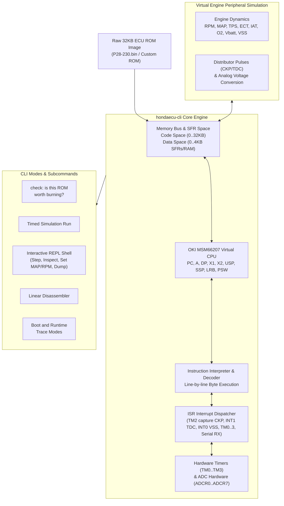

# Honda OBD1 ECU (OKI MSM66207) Emulator & ROM Checker in Rust

[](LICENSE)
[](https://www.rust-lang.org/)

An experimental command-line emulator and ROM checker for the stock
Honda P28 ECU, powered by an OKI MSM66207 16-bit CPU core and a developing
peripheral/board model.

---

## 📚 Documentation Index

- ✅ [**ROM Check (`docs/CHECK.md`)**](docs/CHECK.md): What `check` does, the car values, the script, the rule behind every line, the verdicts, and the assumptions and findings behind them.
- 📖 [**Scripted Stimulus & Fault-Injection Guide (`docs/SCENARIOS.md`)**](docs/SCENARIOS.md): Preset and CSV inputs, plus the boundary between an injected condition and an observed ROM response.
- 🧠 [**OKI MSM66207 CPU Core — Findings & Implementation Notes (`docs/CPU_CORE.md`)**](docs/CPU_CORE.md): Instruction decoding/execution, machine-cycle timing, register and memory models, peripherals, stock-P28 observations, trace tooling, and known gaps.
- 💉 [**Stock P28 Injection (`docs/INJECTION.md`)**](docs/INJECTION.md): How the ROM schedules and drives the injectors, the six defects that kept the emulator from sustaining injection, and how each was verified.
- 📐 [**Honda P28 ECU Architecture Notes (`docs/P28_ARCHITECTURE.md`)**](docs/P28_ARCHITECTURE.md): MSM66207 memory mapping, the P28 analog front end, boot traces, interrupt vectors, and clearly labelled control-strategy hypotheses.

---

## 📌 Architectural Overview



---

## 🔥 Key Features

- **Table-driven MSM66207 core**: Whole instruction patterns are decoded with
  `DD`-aware byte/word selection. Machine-cycle counts come from the manual's
  instruction list for every addressing variant, on-chip and external, with
  taken-branch penalties. Interrupt entry is charged 17 cycles, a figure
  derived from the manual's `RTI` and `VCAL` counts because no available
  document states it.
- **One 5 MHz machine-cycle clock domain**: CPU execution, timers, distributor
  scheduling, replay time, and pulse-width conversion share the same modeled
  clock. Host instructions per second are only a performance measurement.
- **P28 analog front end**: The two board-level 4051 muxes feed ADCR0/ADCR1 and
  share P2.5/P2.6/P2.7 as A/B/C. Direct inputs include optional EGR on AI3,
  MAP on AI6, and TPS on AI7. Conversion takes 64 us: 320 modeled machine
  cycles, equal to 640 oscillator clocks.
- **Timers per the MSM66207 manual**: The 3-bit clock select and all four
  modes (auto reload, clock output, capture register, realtime output) follow
  chapter 9 of the user's manual. CKP arrives as a timer-2 capture edge, TDC on
  INT1, CYP on the transition detector, and VSS on INT0.
- **Sequential injection on the stock ROM**: The injector output stage is
  modeled as the ROM drives it -- P2.0-P2.3 staged, then clocked out by timer
  0's realtime output -- giving one pulse per cylinder per engine cycle from
  cranking speed to the ROM's own rev limit. See `docs/INJECTION.md`.
- **Inspection tools**: Linear disassembly, an interactive shell, replay, an
  experimental TCP datalog server, and boot/runtime `trace` modes for PC/RAM
  watches, histograms, snapshots, execution ranges, and per-output injector
  opening counts and pulse widths.
- **Tracked decoder ground truth**: `tests/fixtures/p28_dasm662.tsv` exercises
  mnemonic and length agreement for 10,914 stock-P28 instruction windows. It
  does not certify every execution semantic, peripheral, or board connection.
- **ROM check**: `check` runs a ROM on the modelled box wired to a described
  car and prints one verdict. See below and `docs/CHECK.md`.
- **DTC name catalogue**: `dtc.rs` only maps fault-code numbers to names. The
  codes `check` reports are the ones the ROM itself blinks on the MIL.

---

## Accuracy and Test Scope

The current tree can execute the stock P28 image through its modeled power-on
path with live mux inputs, but it is not a physical-ECU validator.

- U6 feeds ADCR0 and U5 feeds ADCR1. Confirmed endpoints are U6/X0 HEGO,
  U6/X3 barometric pressure, U5/X0 ELD, U5/X2 ECT, U5/X3 an unresolved
  boot-check signal, direct AI3 optional EGR, AI6 MAP, and AI7 TPS. Battery
  voltage (U6/X7), IAT (U6/X2), the gearbox configuration input (U5/X1) and
  IACV current (AI4) are identified from the ROM and the pgmfi wiki.
- The stock sampler at `0x52DE..0x52F7` stores ADCR0 high bytes at
  `0x03BE[index]` and ADCR1 high bytes at `0x03C6[index]` while advancing the
  shared selector.
- The stock ROM sustains sequential injection: one opening per injector output
  per engine cycle, in rotation, from 300 rpm to its fuel cut between 7000 and
  7500 rpm. Pulse widths come from the ROM's own tables acting on modeled
  sensor voltages; they are plausible, not validated against a datalog.
- The injector output stage (P2.0–P2.3 clocked by TM0IO into a 74HC175) and
  the crank-signal pin assignment (CKP on TM2IO, TDC on INT1, CYP on TRNS0,
  VSS on INT0) were derived from the ROM and are confirmed by the Bomarc
  schematic. The output-to-cylinder mapping and the real sensor phasing are
  not established.
- Fuel-pump, MIL, A/C clutch, fan and purge telemetry follow the board's
  82C55 outputs, whose wiring is read off the schematic; `vtec_active` is
  still emulator-side logic. The feedback paths the ROM monitors (IACV
  current, ignition and injector monitors, backup-MCU heartbeat) are models
  with stated assumptions; see `docs/CPU_CORE.md`.
- PWM0/PWM1 follow the user's manual (PWM, auto reload and free-run modes),
  but which board loads P4.2 and P4.3 drive is not established.
- External data addresses above the 4 KiB backing store currently alias
  (including the digital input port at `0x4700`).
- Three executor flag bugs were found that the decoder ground-truth test cannot
  see. The remaining mnemonics have not been audited against the manual.
- Replay presets are scripted stimuli. They do not by themselves prove a DTC,
  limiter, failsafe, fuel strategy, or physical output. The TCP datalog protocol
  is experimental.

### Testing

Run the Rust suite with:

```bash
cargo test --release        # everything that needs no ROM image
cargo test-rom              # the same plus the ROM-backed tests
```

The tracked `dasm662` fixture is included and runs in both. The stock-ROM and
launch-ROM tests need images that cannot be redistributed, so they are opt-in:

| feature | variable | image | SHA-256 of the first 32768 bytes |
|---|---|---|---|
| `p28-rom` | `HONDAECU_P28_ROM` | stock USDM P28-230 | `20b99338774dc41034229f6afd4c4a6ae8ac22339be26e5474b33ac3388c0d5a` |
| `p30-rom` | `HONDAECU_P30_ROM` | stock JDM P30, mask 203 (the pgmfi wiki's `203stock.bin`) | `c3decae27ff4dec5587df26633107dc7fb1712c91ab501668311941cf8761dfa` |
| `launch-rom` | `HONDAECU_LAUNCH_ROM` | launch-control test ROM | `f7c7aac6250af2ee4ae2a9f26b9b0fe68fd02ef668dd524f2d369c9a78482c8e` |
| `hts-rom` | `HONDAECU_HTS_ROM` | Honda Tuning Suite D16Z6 base ROM (`docs/CHECK.md`, "HTS base ROM"); local only, see below | `3f1ba3ea948ecc68dc67446ee96f828112fb13e35c3c27f0761e278ed300e3d0` |

`rom-fixtures` turns the first three on, and `cargo test-rom` is `cargo test --release
--features rom-fixtures`. `hts-rom` is not part of `rom-fixtures` and CI has
no copy of its image: it is a local opt-in only, `cargo test --release
--features rom-fixtures,hts-rom`, with `HONDAECU_HTS_ROM` defaulting to
`../hts_D16Z6Baserom.bin`. Without a feature its tests are listed as
`ignored, needs the ... ROM`, never as passed. With it, a variable that is
unset or does not name a file fails every test that needs the image, so a
green run means the ROM was there. `.cargo/config.toml` defaults the three
variables to `../P28-230.bin`, `../../ecu/bins/p30_203.bin` and
`../test-roms/lyonnel-2.0-launch-ok.bin`, relative to the checkout; set them
to use other paths:

```bash
HONDAECU_P28_ROM=/roms/P28-230.bin cargo test --release --features p28-rom
```

CI runs the default suite on every push. A second job, `rom-fixtures`, runs
the ROM-backed tests when the repository has the images as secrets
(`P28_230_ROM_GZ_B64`, `P30_ROM_GZ_B64`, `LAUNCH_ROM_GZ_B64`: the image gzip-compressed, then
base64), checks each against the digest above, and fails if a test it exists
for did not run. Without the secrets it reports the fixtures as not
configured and runs nothing.

---

## ⚡ Quickstart & Installation

### Option 1: Download Standalone Binaries (No Rust Required!)
Download the pre-compiled binary for your operating system from [**GitHub Releases**](https://github.com/VIRUXE/hondaecu-cli/releases):

- **Windows (`.exe`)**: Download `hondaecu-cli-windows-x86_64.zip`, extract, and open Command Prompt or PowerShell.
- **Linux (`x86_64`)**: Download `hondaecu-cli-v0.1.0-x86_64-unknown-linux-gnu.tar.gz` and extract `hondaecu-cli`.

### Option 2: Building from Source (Rust Developers)
```bash
git clone https://github.com/VIRUXE/hondaecu-cli.git
cd hondaecu-cli
cargo build --release
```

---

## 📖 Usage Examples

> **Note**: For Windows, replace `./hondaecu-cli` with `.\hondaecu-cli.exe`.

### 1. Check a ROM before burning it
`check` runs the ROM on the modelled P28 box, wired to the car you describe,
through one fixed script (about 92 s of ECU time, roughly 20 s of wall time),
and prints one verdict. `test` is an alias.
```bash
# Linux / macOS: asks about the car when run in a terminal
./hondaecu-cli check P28-230.bin

# Windows (PowerShell / CMD)
.\hondaecu-cli.exe check P28-230.bin

# No questions: a preset, a car file, or --set values; the rest is defaulted
./hondaecu-cli check my-rom.bin --no-prompt
./hondaecu-cli check my-rom.bin --car stock-p28-automatic --set knock_sensor=no
./hondaecu-cli check my-rom.bin --car my-civic.txt --report result.json
```

The car comes from, in order: a preset (`stock-p28-manual`,
`stock-p28-automatic`, `stock-p30`), a car file of `key = value` lines
(`--car <file>`), `--set key=value` and the shorthands `--ecu` and
`--board-gearbox`, then questions when run in a terminal (skip them with
`--no-prompt`). Anything you did not give is listed as `defaulted` in the
report. The questions can save your answers to a file for `--car`; keys you
took the default for are saved as comments, and the file starts with
`preset = <name>` (a hand-written file may have that line too), so the same
car is checked and the same keys stay defaulted when it is used again.

There are three verdicts:

| verdict | exit status | meaning |
|---|---|---|
| `WORTH BURNING` | 0 | everything the script looked at looked right |
| `DO NOT BURN` | 1 | something was wrong; the verdict names the first problem |
| `COULD NOT TELL` | 3 | nothing was wrong, but something could not be judged |

Exit status 2 is a bad command line or a file that cannot be read or
written. The check does not judge fuelling, ignition timing, or anything that
needs a responding engine. A car value the board model cannot represent
(listed in [`docs/CHECK.md`](docs/CHECK.md), "Which values change the run
today") is named on a `car as described` line, and the verdict is then never
`WORTH BURNING`.
### 2. ECU Datalog CSV Replay & Scripted Trace Playback
Replay a CSV log or scripted sensor preset through the emulator and export its
observed output fields. Scenario names describe stimuli, not verified ROM
responses:
```bash
# Replay built-in dyno pull preset (2000 -> 8200 RPM WOT)
./hondaecu-cli replay P28-230.bin dyno-pull output_results.csv

# Replay a MAP-fault stimulus; inspect the ROM response separately
./hondaecu-cli replay P28-230.bin error-map-failure

# Replay custom CSV datalog file
./hondaecu-cli replay P28-230.bin my_ecu_log.csv output_results.csv
```

CSV Format (`my_ecu_log.csv`):
```csv
timestamp_ms,rpm,map_kpa,tps_pct,ect_celsius,iat_celsius,o2_volts,vbatt_volts,speed_kmh
0,800,30,0,85,25,0.45,14.2,0
100,2200,45,15,85,25,0.45,14.2,20
200,4800,95,100,85,25,0.85,14.1,80
```

Available presets include `dyno-pull`, `overrun-decel`, `accel-stomp`,
`drag-pass`, `launch-control-2step`, the `error-*` stimuli, `cold-start`,
`electrical-load-idle`, and `heat-soak-start`. See
[`docs/SCENARIOS.md`](docs/SCENARIOS.md) for the complete list.

### 3. Live Serial Datalogging Protocol Server
Start the experimental TCP datalogging server on port `38400` for protocol
development. Client compatibility and real-time cadence are not guaranteed:
```bash
# Linux / macOS
./hondaecu-cli datalog P28-230.bin 38400

# Windows (PowerShell / CMD)
.\hondaecu-cli.exe datalog P28-230.bin 38400
```

### 4. ECU Simulation Run
Execute 100,000 instructions with a scripted 3000 RPM input:
```bash
./hondaecu-cli run P28-230.bin 100000 3000
```

### 5. Interactive Debugging REPL
Launch the interactive shell to single-step, inspect registers, and manipulate virtual engine parameters in real time:
```bash
./hondaecu-cli interactive P28-230.bin
```

Interactive commands:
```text
ecu [0x21E2]> step 5
ecu [0x21EA]> regs
ecu [0x21EA]> set rpm 6500
ecu [0x21EA]> set map 100
ecu [0x21EA]> set tps 100
ecu [0x21EA]> status
ecu [0x21EA]> dump 0x0060 16
```

### 6. Machine Code Disassembler
Linearly decode instructions starting at a hexadecimal ROM offset without
executing them:
```bash
./hondaecu-cli disasm P28-230.bin 0x21E2 20
```

### 7. Boot and Runtime Trace

The `trace` command emits machine-readable PC/RAM observations. Runtime modes
include `ramwatch`, `pcwatch`, `pccount`, `pchist`, `snap`, `exec`, and
`injcount`; `bootpc` and `bootram` inspect the raw power-on path.

`injcount` prints `INJ o0 o1 o2 o3 total n` (openings per injector output in
the window) and `INJPW_US w0 w1 w2 w3` (last completed pulse width per output,
in microseconds). `ramwatch` lines end with the machine-cycle count.

```bash
./hondaecu-cli trace P28-230.bin injcount 3000 1.0
./hondaecu-cli trace P28-230.bin pchist 5500 1.0 25
./hondaecu-cli trace P28-230.bin bootpc 0 0 0x220E,0x2211,0x2213,0x2426
```

---

## 🚦 Honda OBD1 Diagnostic Trouble Code (DTC) Names

This is only the catalogue of names `check` uses to label a code. It says
nothing about which codes the emulator or a ROM can set: `check` reports the
codes the ROM blinks on the MIL, whatever they are.

| DTC Code | Component Name | Description & Fault Condition |
|---|---|---|
| **DTC 0** | ECU Internal ROM | Corrupt Checksum / Modulo Sum Mismatch (Solid CEL) |
| **DTC 1** | Primary O2 Sensor | Signal out of range (<0.1V / >1.1V / Open circuit) |
| **DTC 2** | Secondary O2 Sensor | Secondary O2 circuit fault (JDM / Lean spot) |
| **DTC 3** | MAP Sensor High/Low | Manifold Absolute Pressure sensor out of bounds |
| **DTC 4** | CKP Position Sensor | Crankshaft position pulse signal missing at high RPM |
| **DTC 5** | MAP Sensor Range | Vacuum mismatch vs engine RPM/TPS |
| **DTC 6** | ECT Engine Temp | Coolant temp sensor open (<0.2V) or shorted (>4.8V) |
| **DTC 7** | TPS Throttle Sensor | Throttle position voltage out of bounds (<0.3V or >4.8V) |
| **DTC 8** | TDC Sensor Pulses | Top Dead Center distributor pulse sync fault |
| **DTC 9** | CYP Sensor Pulses | Cylinder position pulse phase fault |
| **DTC 10** | IAT Intake Air Temp | Air temp voltage open (<0.2V) or shorted (>4.8V) |
| **DTC 11** | Ignition Module | Distributor igniter module pulse missing |
| **DTC 12** | EGR System | EGR valve position sensor out of range |
| **DTC 13** | BARO Sensor | Atmospheric pressure sensor internal circuit fault |
| **DTC 14** | IACV Idle Valve | Idle Air Control Valve open/short circuit |
| **DTC 15** | Ignition Coil Output | Ignition coil primary circuit failure |
| **DTC 16** | Injector Driver | Fuel injector driver transistor open/short |
| **DTC 17** | VSS Speed Sensor | Missing speed pulse while RPM > 2000 & high MAP |
| **DTC 19** | A/T Lockup Solenoid | Automatic transmission lockup solenoid circuit fault |
| **DTC 20** | ELD Load Detector | Fuse box ELD current sensor out of range |
| **DTC 21** | VTEC Solenoid | VTEC solenoid coil open/short circuit |
| **DTC 22** | VTEC Pressure Switch | Low oil pressure / switch open when VTEC commanded |
| **DTC 23** | Knock Sensor (KS) | Knock sensor circuit open or signal noise fault |
| **DTC 30** | A/T Shift Signal A | Automatic transmission shift solenoid A circuit |
| **DTC 31** | A/T Shift Signal B | Automatic transmission shift solenoid B circuit |
| **DTC 41** | O2 Sensor Heater | Oxygen sensor heater element circuit open/short |
| **DTC 43** | Fuel Supply System | Fuel pressure or O2 trim lean limit exceeded |
| **DTC 45** | Fuel System Rich/Lean | Air/Fuel ratio out of closed-loop correction range |
| **DTC 48** | LAF Wideband Sensor | Linear air-fuel ratio sensor circuit fault (Civic VX) |
| **DTC 92** | EVAP Purge Solenoid | Evaporative emissions purge solenoid circuit |

---

## 📂 Project Directory Structure

```text
hondaecu-cli/
├── Cargo.toml
├── README.md
├── LICENSE
├── docs/               # CHECK.md, SCENARIOS.md, CPU_CORE.md, INJECTION.md, P28_ARCHITECTURE.md
└── src/
    ├── main.rs         # CLI Entrypoint & subcommand dispatcher
    ├── check.rs        # The `check` command: arguments, questions, car file, report output
    ├── car.rs          # The car: presets, car-file format, defaulted values
    ├── wiring.rs       # Applies a car to the board model
    ├── bench.rs        # The ECU box on a bench: run log, settling, MIL edges
    ├── script.rs       # The fixed sequence of driving conditions and what it observes
    ├── blink.rs        # Reads fault codes back from the MIL's blinks
    ├── verdict.rs      # Three-state lines and the verdict
    ├── report.rs       # Text and JSON rendering of the verdict
    ├── cpu.rs          # OKI MSM66207 CPU Register File & PSW Flags
    ├── bus.rs          # Memory Bus (32KB ROM / 4KB RAM), Timers, SFRs, ADC, PWM
    ├── engine.rs       # Virtual Engine Simulator, Sensor Signals, Distributor Pulses
    ├── interpreter.rs  # Machine Code Opcode Decoder & Interpreter
    ├── interrupts.rs   # ISR Vector Dispatcher (TM0-TM3, INT0, INT1, Serial RX)
    ├── dtc.rs          # Honda OBD1 fault-code names
    └── interactive.rs  # Interactive Debugging REPL Shell
```
---

## 📜 License

This is free and unencumbered software released into the public domain under [The Unlicense](LICENSE).
