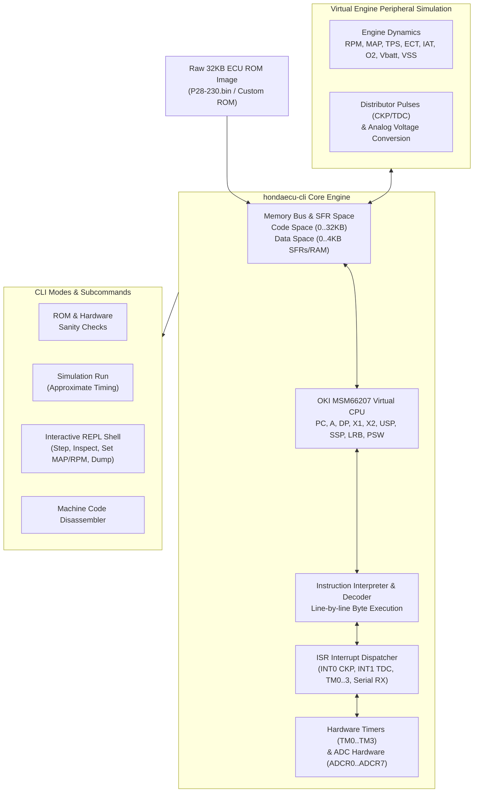

# Honda OBD1 ECU (OKI MSM66207) Emulator & ROM Testing Suite in Rust

[](LICENSE)
[](https://www.rust-lang.org/)

An experimental command-line emulator and ROM inspection suite for **Honda OBD1 ECUs** powered by an OKI MSM66207 16-bit CPU core and a developing peripheral model.

---

## 📚 Documentation Index

- 📖 [**Real-World Scenario Playback Guide (`docs/SCENARIOS.md`)**](docs/SCENARIOS.md): Complete guide to preset runtime engine scenarios (Overrun DFCO, Drag Strip Pass, Accel Tip-In Stomp, VTEC Hysteresis, Electrical Idle Load, Heat Soak Start, Cold Start) and writing custom CSV datalog traces.
- 🧠 [**OKI MSM66207 CPU Core — Findings & Implementation Notes (`docs/CPU_CORE.md`)**](docs/CPU_CORE.md): Instruction decoding and execution, the register/memory model, primary-manual findings, the currently inaccurate PWM shim, opt-in ROM observations, and known gaps.
- 📐 [**Honda P28 ECU Architecture Notes (`docs/P28_ARCHITECTURE.md`)**](docs/P28_ARCHITECTURE.md): MSM66207 memory mapping, SFRs, interrupt vectors, and clearly labelled hypotheses about P28 control strategy and board wiring.

---

## 📌 Architectural Overview



---

## 🔥 Key Features

- **Table-Driven OKI MSM66207 Virtual CPU**: Decodes whole instruction patterns with `DD`-aware word/byte selection. An opt-in external `dasm662` fixture checks mnemonic and length coverage; it does not certify execution semantics or timing for every opcode.
- **Peripheral and Interrupt Model**: Simulates hardware timers and distributor interrupts; exact per-instruction clock counts remain an explicit known gap.
- **ADC Hardware & Sensor Simulation**: Direct synthetic sensor values feed eight 10-bit channels. `ADSCAN.4` schedules a completion after 640 modeled ticks, then all eight read-only `ADCR0`–`ADCR7` latches update in left-justified format and ADC IRQ bit 12 is raised. Channel scanning and the P28 external analog multiplexer are not modeled.
- **Board-I/O Boundaries Kept Explicit**: The emulator measures active-low transitions on P2.0–P2.3 under its current injector assumption, but the conflicting P28 board mapping is unresolved. Trustworthy VTEC, IACV, fuel-pump, and other board-output telemetry is unavailable.
- **Experimental TCP Datalog Server**: Provides ID, ping, framed sensor packets, and checksums for protocol exploration. Compatibility and real-time 20 Hz throughput are not yet claimed.
- **Observable Stock-P28 Sanity Checks**: The CLI checks image shape/checksum, selected P28 vectors, a recognized runtime entry, direct ADC latching, IRQ plumbing, assumed P2 pulse capture, and UART RX plumbing. This is not CPU, ROM, ECU, or hardware certification.
- **Honda OBD1 DTC Catalog**: Includes reference metadata; firmware-level detection for the listed codes is not validated.
- **Interactive REPL Console**: Live interactive shell to step instructions, set RPM/MAP/TPS parameters, dump memory, and monitor measured injector transitions. VTEC/IACV telemetry remains unavailable until board mappings are verified.
- **Release Builds**: Optimized builds are substantially faster than debug builds; throughput depends on the host and scenario.

---

## Accuracy and Test Scope

The emulator is useful for inspection and development, but the open fidelity
issues below materially limit physical-ECU conclusions:

| Issue | Current behavior |
|---|---|
| [#1](https://github.com/VIRUXE/hondaecu-cli/issues/1) | The P28 external analog multiplexer is absent. Replay boots with neutral direct ADC inputs, then applies scenario values straight to modeled MCU channels. |
| [#2](https://github.com/VIRUXE/hondaecu-cli/issues/2) | P28 board-output mapping is unresolved, including a P2.0 injector/fuel-pump conflict. P2.0–P2.3 pulse measurement is an emulator assumption, not verified harness behavior. |
| [#3](https://github.com/VIRUXE/hondaecu-cli/issues/3) | Timer compare/free-running behavior is modeled, but the documented auto-reload mode is not. |
| [#4](https://github.com/VIRUXE/hondaecu-cli/issues/4) | ADC conversion now waits 640 modeled ticks instead of the old 64-tick shortcut and latches all eight left-justified 10-bit results. Scan selection remains simplified, and wall-clock accuracy depends on #8. |
| [#5](https://github.com/VIRUXE/hondaecu-cli/issues/5) | The distributor generator emits at most one edge per call and re-anchors its schedule, introducing a small period stretch. |
| [#6](https://github.com/VIRUXE/hondaecu-cli/issues/6) | The current P28 run does not sustain sequential injection; occasional prime/batch transitions are not proof of normal runtime fueling. |
| [#7](https://github.com/VIRUXE/hondaecu-cli/issues/7) | **PWM remains inaccurate.** The implementation toggles an output on counter overflow and treats `PWMR` as a reload value. The manual's PWM mode instead derives the period from the time-base counter and duty from `PWMR`, subject to `PWCON` mode/run/polarity behavior. |
| [#8](https://github.com/VIRUXE/hondaecu-cli/issues/8) | **Opcode timing is approximate.** `cpu.cycles` advances by decoded instruction byte length, not the manual's internal/external clock count, so timers, ADC, distributor scheduling, and reported microseconds are approximate. Host instructions/second is not virtual CPU clock speed. |
| [#9](https://github.com/VIRUXE/hondaecu-cli/issues/9) | ROM-backed Rust tests require external ROM fixtures and are ignored by default. Normal `cargo test` and CI exercise fixture-free tests only. |
| [#10](https://github.com/VIRUXE/hondaecu-cli/issues/10) | TCP datalog framing, client compatibility, field availability, and stream cadence remain experimental. |

The built-in scenarios inject stimuli; they do not by themselves verify a DTC,
failsafe, fuel strategy, or physical output. See [the scenario guide](docs/SCENARIOS.md)
for the observation boundary.

### Rust tests and external ROM fixtures

Run the normal fixture-free suite with:

```bash
cargo test --release
```

ROM-backed tests are opt-in and require ROMs that cannot be distributed with
the project. Run them explicitly, for example:

```bash
HONDAECU_P28_ROM=/path/to/P28-230.bin \
  cargo test --release oem_rom_passes_its_cpu_self_test -- --ignored
HONDAECU_P28_ROM=/path/to/P28-230.bin \
  cargo test --release finds_p28_runtime_entry_after_the_hardware_checks -- --ignored

HONDAECU_DASM662_FIXTURE=/path/to/p28_dasm662.tsv \
  cargo test --release matches_dasm662_ground_truth -- --ignored

HONDAECU_LAUNCH_ROM=/path/to/launch-control.bin \
  cargo test --release finds_launch_rom_runtime_entry_after_the_hardware_checks -- --ignored
HONDAECU_LAUNCH_ROM=/path/to/launch-control.bin \
  cargo test --release launch_rom_reaches_runtime_and_drives_an_injector -- --ignored
```

An absent fixture is not a passing ROM test, and the default CI workflow does
not run these ignored cases.

---

## ⚡ Quickstart & Installation

### Option 1: Download Standalone Binaries (No Rust Required!)
Download the pre-compiled binary for your operating system from [**GitHub Releases**](https://github.com/VIRUXE/hondaecu-cli/releases):

- **Windows (`.exe`)**: Download `hondaecu-cli-v0.1.0-windows-x86_64.zip`, extract, and open Command Prompt or PowerShell.
- **Linux (`x86_64`)**: Download `hondaecu-cli-v0.1.0-linux-x86_64.tar.gz` and extract `hondaecu-cli`.

### Option 2: Building from Source (Rust Developers)
```bash
git clone https://github.com/VIRUXE/hondaecu-cli.git
cd hondaecu-cli
cargo build --release
```

---

## 📖 Usage Examples

> **Note**: For Windows, replace `./hondaecu-cli` with `.\hondaecu-cli.exe`.

### 1. Run Stock P28-230 ROM & Hardware Sanity Checks
```bash
# Linux / macOS
./hondaecu-cli test P28-230.bin

# Windows (PowerShell / CMD)
.\hondaecu-cli.exe test P28-230.bin
```

### 2. ECU Datalog CSV Replay & Scripted Trace Playback
Replay an actual CSV driving log or scripted sensor preset through the ECU and export observed injector output. Scenario labels are stimuli, not automatic DTC or behavior assertions:
```bash
# Replay built-in dyno pull preset (2000 -> 8200 RPM WOT)
./hondaecu-cli replay P28-230.bin dyno-pull output_results.csv

# Replay a MAP-fault stimulus; DTC 3/5 remains an observation target
./hondaecu-cli replay P28-230.bin error-map-failure

# Replay custom CSV datalog file
./hondaecu-cli replay P28-230.bin my_ecu_log.csv output_results.csv
```

CSV Format (`my_ecu_log.csv`):
```csv
timestamp_ms,rpm,map_kpa,tps_pct,ect_celsius,iat_celsius,o2_volts,vbatt_volts,speed_kmh
0,800,30,0,85,25,0.45,14.2,0
100,2200,45,15,85,25,0.45,14.2,20
200,4800,95,100,85,25,0.85,14.1,80
```

Available presets include `dyno-pull`, `overrun-decel`, `accel-stomp`, `drag-pass`, `launch-control-2step`, `error-map-failure`, `error-ect-overheat`, `error-tps-short`, `error-vtec-oil-pressure-loss`, `cold-start`, `electrical-load-idle`, and `heat-soak-start`. See [`docs/SCENARIOS.md`](docs/SCENARIOS.md) for the complete list and limitations.

### 3. Live Serial Datalogging Protocol Server
Start the experimental TCP datalogging server on port `38400` for protocol development:
```bash
# Linux / macOS
./hondaecu-cli datalog P28-230.bin 38400

# Windows (PowerShell / CMD)
.\hondaecu-cli.exe datalog P28-230.bin 38400
```

### 4. ECU Simulation Run
Execute 100,000 instructions at a simulated 3000 RPM. Peripheral timing is approximate until per-opcode cycle counts are implemented:
```bash
./hondaecu-cli run P28-230.bin 100000 3000
```

### 4. Interactive Debugging REPL
Launch the interactive shell to single-step, inspect registers, and manipulate virtual engine parameters in real time:
```bash
./hondaecu-cli interactive P28-230.bin
```

Interactive commands:
```text
ecu [0x21E2]> step 5
ecu [0x21EA]> regs
ecu [0x21EA]> set rpm 6500
ecu [0x21EA]> set map 100
ecu [0x21EA]> set tps 100
ecu [0x21EA]> status
ecu [0x21EA]> dump 0x0060 16
```

### 5. Machine Code Disassembler
Disassemble instructions starting at a given hexadecimal memory offset:
```bash
./hondaecu-cli disasm P28-230.bin 0x21E2 20
```

---

## 🚦 Honda OBD1 Diagnostic Trouble Code (DTC) Matrix

The catalog below is reference metadata. `CATALOGUED` means the code is listed; it does not mean the emulator has observed the ROM setting that DTC.

| DTC Code | Component Name | Description & Fault Condition | Status |
|---|---|---|---|
| **DTC 0** | ECU Internal ROM | Corrupt Checksum / Modulo Sum Mismatch (Solid CEL) | **CATALOGUED** |
| **DTC 1** | Primary O2 Sensor | Signal out of range (<0.1V / >1.1V / Open circuit) | **CATALOGUED** |
| **DTC 2** | Secondary O2 Sensor | Secondary O2 circuit fault (JDM / Lean spot) | **CATALOGUED** |
| **DTC 3** | MAP Sensor High/Low | Manifold Absolute Pressure sensor out of bounds | **CATALOGUED** |
| **DTC 4** | CKP Position Sensor | Crankshaft position pulse signal missing at high RPM | **CATALOGUED** |
| **DTC 5** | MAP Sensor Range | Vacuum mismatch vs engine RPM/TPS | **CATALOGUED** |
| **DTC 6** | ECT Engine Temp | Coolant temp sensor open (<0.2V) or shorted (>4.8V) | **CATALOGUED** |
| **DTC 7** | TPS Throttle Sensor | Throttle position voltage out of bounds (<0.3V or >4.8V) | **CATALOGUED** |
| **DTC 8** | TDC Sensor Pulses | Top Dead Center distributor pulse sync fault | **CATALOGUED** |
| **DTC 9** | CYP Sensor Pulses | Cylinder position pulse phase fault | **CATALOGUED** |
| **DTC 10** | IAT Intake Air Temp | Air temp voltage open (<0.2V) or shorted (>4.8V) | **CATALOGUED** |
| **DTC 11** | Ignition Module | Distributor igniter module pulse missing | **CATALOGUED** |
| **DTC 12** | EGR System | EGR valve position sensor out of range | **CATALOGUED** |
| **DTC 13** | BARO Sensor | Atmospheric pressure sensor internal circuit fault | **CATALOGUED** |
| **DTC 14** | IACV Idle Valve | Idle Air Control Valve open/short circuit | **CATALOGUED** |
| **DTC 15** | Ignition Coil Output | Ignition coil primary circuit failure | **CATALOGUED** |
| **DTC 16** | Injector Driver | Fuel injector driver transistor open/short | **CATALOGUED** |
| **DTC 17** | VSS Speed Sensor | Missing speed pulse while RPM > 2000 & high MAP | **CATALOGUED** |
| **DTC 19** | A/T Lockup Solenoid | Automatic transmission lockup solenoid circuit fault | **CATALOGUED** |
| **DTC 20** | ELD Load Detector | Fuse box ELD current sensor out of range | **CATALOGUED** |
| **DTC 21** | VTEC Solenoid | VTEC solenoid coil open/short circuit | **CATALOGUED** |
| **DTC 22** | VTEC Pressure Switch | Low oil pressure / switch open when VTEC commanded | **CATALOGUED** |
| **DTC 23** | Knock Sensor (KS) | Knock sensor circuit open or signal noise fault | **CATALOGUED** |
| **DTC 30** | A/T Shift Signal A | Automatic transmission shift solenoid A circuit | **CATALOGUED** |
| **DTC 31** | A/T Shift Signal B | Automatic transmission shift solenoid B circuit | **CATALOGUED** |
| **DTC 41** | O2 Sensor Heater | Oxygen sensor heater element circuit open/short | **CATALOGUED** |
| **DTC 43** | Fuel Supply System | Fuel pressure or O2 trim lean limit exceeded | **CATALOGUED** |
| **DTC 45** | Fuel System Rich/Lean | Air/Fuel ratio out of closed-loop correction range | **CATALOGUED** |
| **DTC 48** | LAF Wideband Sensor | Linear air-fuel ratio sensor circuit fault (Civic VX) | **CATALOGUED** |
| **DTC 92** | EVAP Purge Solenoid | Evaporative emissions purge solenoid circuit | **CATALOGUED** |

---

## 📂 Project Directory Structure

```text
hondaecu-cli/
├── Cargo.toml
├── README.md
├── LICENSE
└── src/
    ├── main.rs         # CLI Entrypoint & subcommand dispatcher
    ├── cpu.rs          # OKI MSM66207 CPU Register File & PSW Flags
    ├── bus.rs          # Memory Bus (32KB ROM / 4KB RAM), Timers, SFRs, ADC, PWM
    ├── engine.rs       # Virtual Engine Simulator, Sensor Signals, Distributor Pulses
    ├── decoder.rs      # Whole-pattern, DD-aware instruction decoder
    ├── operand.rs      # Parsed OKI 66K operand/addressing model
    ├── exec.rs         # Instruction execution semantics
    ├── interpreter.rs  # CLI adapter for execution and linear disassembly
    ├── interrupts.rs   # ISR Vector Dispatcher (INT0, INT1, TM0-TM3, Serial RX)
    ├── dtc.rs          # Honda OBD1 DTC metadata and selected stimuli
    ├── suite.rs        # Observable ROM and hardware sanity checks
    └── interactive.rs  # Interactive Debugging REPL Shell
```

---

## 📜 License

This is free and unencumbered software released into the public domain under [The Unlicense](LICENSE).
