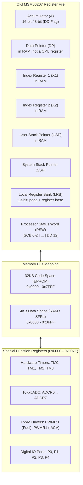

# Honda P28 OBD1 ECU Architecture & ROM Specification

This document provides a technical deep-dive into the hardware architecture, memory map, interrupt vectors, calculation algorithms, and diagnostic subsystems of the **Honda OBD1 ECU** (P28, P30, P72, PR4) powered by the **OKI MSM66207 16-bit Microcontroller**.

---

## 📌 Microcontroller Architecture (OKI MSM66207)

### CPU Specifications
- **Architecture**: OKI MSM66207 16-bit Microcontroller
- **Clock Speed**: 12.000 MHz Crystal Oscillator (~12 MIPS instruction throughput)
- **Data Bus**: 16-bit internal architecture
- **PSW Status Word** (per the OKI MSM66201 Instruction Manual):
  - `SCB` (Bits 0–2): **System Control Base** — selects which pointing-register
    set `PR0..PR7` is live. `X1`, `X2`, `DP` and `USP` are *not* CPU registers:
    they live in RAM at `0x0080 + SCB*8`.
  - Bits 3, 6, 7: unimplemented, **read as 1**.
  - `DD` (Bit **12**): Word/Byte mode (`DD = 1`: 16-bit; `DD = 0`: 8-bit).
    Also gates instruction *decoding* — `0x18` is `ADC A, er0` under DD=1 but
    `ADCB A, r0` under DD=0.
  - `ZF`, `CF` (borrow polarity: `CF = 1` on borrow / less-than) and `HC` are the
    only other defined flags. Their exact bit positions are not stated in the
    manual. There is no interrupt-enable bit in PSW on this core.

> ⚠️ Earlier revisions of this document listed PSW as `[ZF|CF|HC|DD|IE]` in bits
> 0–7 and treated `X1/X2/DP/USP` as CPU registers. Both were wrong. See
> [`docs/CPU_CORE.md`](CPU_CORE.md) for the corrected model and its evidence.

---

## 🗺️ Memory Map & Addressing

| Address Range | Memory Type | Function / Content |
|---|---|---|
| `0x0000` – `0x007F` | **SFR Space** | Special Function Registers (Timers, ADC, PWM, I/O Ports) |
| `0x0080` – `0x00BF` | **Pointing Registers** | 8 sets `PR0..PR7`, each `X1, X2, DP, USP`; the live set is chosen by PSW `SCB` |
| `0x00C0` – `0x0FFF` | **Data RAM** | Internal Data RAM (Transient engine variables, learned trims) |
| `0x0000` – `0x7FFF` | **Code ROM** | 32KB External EPROM (Machine code instructions, Fuel & Ignition 3D Lookup Tables) |

---

## ⚡ Interrupt Vector Table

| Vector Address | Priority | Trigger Source | ECU Function |
|---|---|---|---|
| `0x0000` | 0 (Highest) | Power-On Reset | CPU Initialization & System Self-Test |
| `0x0002` | 1 | `INT0` | **Crankshaft Position (CKP)** distributor pulse interrupt |
| `0x0004` | 2 | `INT1` | **Top Dead Center (TDC) / CYP** cylinder sync pulse interrupt |
| `0x0006` | 3 | `TM0` | **Fuel Injector Timer ISR** (Controls injection pulse duration) |
| `0x0008` | 4 | `TM1` | **ADC Sensor Sampling ISR** (Samples MAP, TPS, ECT, IAT, O2 every few ms) |
| `0x000A` | 5 | `TM2` | **Idle Air Control (IACV) PWM ISR** (100 Hz idle valve duty cycle) |
| `0x000C` | 6 | `TM3` | **Ignition Coil Dwell Timer ISR** (Controls spark timing advance & dwell) |
| `0x01FD` | 7 | UART Serial RX | **Serial Datalogging Protocol ISR** (38,400 Baud HTS / Neptune interface) |

---

## 🧮 ECU Mathematical Calculations

### 1. Fuel Injector Pulse Width Formula ($T_{inj}$)

The ECU calculates total fuel injection duration per pulse using the following equation:

$$T_{inj} = \left( T_{base}(\text{RPM}, \text{MAP}) \times K_{ect}(T_{ect}) \times K_{iat}(T_{iat}) \times K_{accel}\left(\frac{d\text{TPS}}{dt}\right) \times K_{\lambda} \right) + T_{dead}(V_{batt})$$

Where:
- $T_{base}(\text{RPM}, \text{MAP})$: Base fuel lookup from 20x20 3D ROM fuel grid.
- $K_{ect}(T_{ect})$: Engine coolant temperature warmup multiplier (e.g., $1.45\times$ at -10°C; $1.00\times$ at 85°C).
- $K_{iat}(T_{iat})$: Air density temp correction multiplier.
- $K_{accel}$: Transient acceleration tip-in enrichment multiplier.
- $K_{\lambda}$: Closed-loop O2 sensor feedback correction trim.
- $T_{dead}(V_{batt})$: Injector opening dead-time latency compensation ($1200\,\mu\text{s}$ at 11V; $650\,\mu\text{s}$ at 14V).

> **Emulation status.** Driven by the crank-angle CKP/CYP/TDC generator, the ROM
> *does* compute a physical pulse width every TDC (~5–6 ms at 5500 rpm, read from
> the active-low P2.0–P2.3 driver transitions). What is **not** yet achieved is
> *sustained running* injection: the ROM only drives the injectors ~1×/second (a
> batch prime) because the main loop that arms them (`0x4BCC`) completes ~1–2
> passes/second. Full root-cause analysis and the missing-datasheet blocker are
> in `docs/CPU_CORE.md` §8 (gap 3) and task #5.

### 2. Ignition Advance Calculation ($\theta_{spark}$)

$$\theta_{spark} = \theta_{base}(\text{RPM}, \text{MAP}) + \theta_{ect} + \theta_{iat} - \theta_{knock}$$

Where $\theta_{base}$ is interpolated from the 20x20 ROM ignition advance matrix in degrees Before Top Dead Center (° BTDC).

---

## 🏎️ VTEC Spool Valve & Pressure Switch Hysteresis

The P28 VTEC spool valve solenoid output is engaged when **all** of the following conditions are simultaneously met:

1. **Engine Speed**: $\text{RPM} \ge 4,800\,\text{RPM}$ (Low-to-High Cam Crossover).
2. **Throttle Position**: $\text{TPS} \ge 20\%$.
3. **Coolant Temp**: $\text{ECT} \ge 60^\circ\text{C}$.
4. **Vehicle Speed**: $\text{VSS} \ge 5\,\text{km/h}$.
5. **Oil Pressure Switch**: VTEC Oil Pressure Switch contacts closed (High hydraulic pressure confirmed).

If the ECU commands VTEC solenoid engagement but the oil pressure switch remains open, the ECU disengages VTEC after a short hysteresis window and triggers **DTC 22 (VTEC Pressure Switch Fault)**.

---

## 🚦 Diagnostic Trouble Code (DTC) Pipeline

The ECU continually monitors sensor hardware channels:
- **Voltage Bounds**: Sensors returning $<0.2\text{V}$ (shorted to ground) or $>4.8\text{V}$ (open circuit) trigger corresponding DTC codes (DTC 1, 3, 6, 7, 10, 14, 21, 22).
- **Distributor Pulse Sync**: Missing CKP/TDC/CYP pulses while RPM $> 2000$ trigger DTC 4, 8, or 9.
- **Internal ROM Checksum**: Modulo sum verification of 32KB ROM space; mismatch triggers DTC 0 (Solid Check Engine Light).
