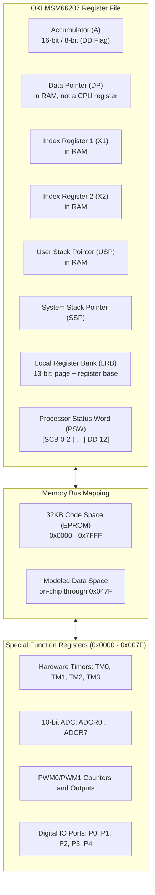

# Honda P28 OBD1 ECU Architecture Notes

This document separates MSM66207 facts from P28 ROM/board hypotheses. It is not
a specification for every Honda OBD1 ECU or proof of physical ECU behavior.

---

## 📌 Microcontroller Architecture (OKI MSM66207)

### CPU Specifications
- **Architecture**: OKI MSM66207 16-bit Microcontroller
- **Clock Source Used by the P28 Model**: 12.000 MHz. This is not 12 MIPS;
  opcode cycle accounting is not implemented yet.
- **Data Bus**: 16-bit internal architecture
- **PSW Status Word** (per the OKI MSM66201 Instruction Manual):
  - `SCB` (Bits 0–2): **System Control Base** — selects which pointing-register
    set `PR0..PR7` is live. `X1`, `X2`, `DP` and `USP` are *not* CPU registers:
    they live in RAM at `0x0080 + SCB*8`.
  - Bits 3, 6, 7, 10, 11: unimplemented, **read as 1**.
  - `DD` (Bit **12**): Word/Byte mode (`DD = 1`: 16-bit; `DD = 0`: 8-bit).
    Also gates instruction *decoding* — `0x18` is `ADC A, er0` under DD=1 but
    `ADCB A, r0` under DD=0.
  - `CF` (bit 15), `ZF` (14), `HC` (13), and `DD` (12) are documented by the
    MSM66201/207 datasheet.
  - `MIE` (bit 8) globally enables maskable interrupts; the `IE` SFR supplies
    the per-source mask. Interrupt entry clears MIE and RTI restores it.

> ⚠️ Earlier revisions of this document listed PSW as `[ZF|CF|HC|DD|IE]` in bits
> 0–7 and treated `X1/X2/DP/USP` as CPU registers. Both were wrong. See
> [`docs/CPU_CORE.md`](CPU_CORE.md) for the corrected model and its evidence.

---

## 🗺️ Memory Map & Addressing

| Address Range | Memory Type | Function / Content |
|---|---|---|
| `0x0000` – `0x007F` | **SFR Space** | Special Function Registers (Timers, ADC, PWM, I/O Ports) |
| `0x0080` – `0x00BF` | **Pointing Registers** | 8 sets `PR0..PR7`, each `X1, X2, DP, USP`; the live set is chosen by PSW `SCB` |
| `0x00C0` – `0x047F` | **On-chip Data RAM** | Internal transient state and learned trims |
| `0x0480` – `0x0FFF` | **Modeled External Data Space** | Emulator-provided expansion; not on-chip MSM66207 RAM |
| `0x0000` – `0x7FFF` | **Code ROM** | 32KB External EPROM (Machine code instructions, Fuel & Ignition 3D Lookup Tables) |

---

## ⚡ Interrupt Vector Table

| Vector Address | Priority | Trigger Source | ECU Function |
|---|---|---|---|
| `0x0000` | — | Reset | Reset handler address |
| `0x0002` | — | BRK | Software-break handler address |
| `0x0004` | — | Watchdog / opcode trap | Trap handler address |
| `0x0006` | — | NMI | Non-maskable-interrupt handler address |
| `0x0008 + 2n` | IRQ bit `n` | IRQ/IE sources 0–15 | Sixteen handler words through `0x0026` |

For the P28-230 ROM, IRQ bit 0 points to handler `0x01D3` (INT0) and bit 1
points to `0x01FD` (serial RX). Those are handler targets stored in the table,
not architectural vector addresses.

---

## 🧮 Conceptual ECU Calculations

The formulas below are conceptual dependency diagrams, not decoded P28
equations, table dimensions, constants, or validation assertions.

### 1. Fuel Injector Pulse Width Formula ($T_{inj}$)

The ECU calculates total fuel injection duration per pulse using the following equation:

$$T_{inj} = \left( T_{base}(\text{RPM}, \text{MAP}) \times K_{ect}(T_{ect}) \times K_{iat}(T_{iat}) \times K_{accel}\left(\frac{d\text{TPS}}{dt}\right) \times K_{\lambda} \right) + T_{dead}(V_{batt})$$

Where:
- $T_{base}(\text{RPM}, \text{MAP})$: Candidate base-fuel lookup dependency.
- $K_{ect}(T_{ect})$: Candidate coolant-temperature correction.
- $K_{iat}(T_{iat})$: Air density temp correction multiplier.
- $K_{accel}$: Transient acceleration tip-in enrichment multiplier.
- $K_{\lambda}$: Closed-loop O2 sensor feedback correction trim.
- $T_{dead}(V_{batt})$: Candidate battery-voltage dead-time correction.

### 2. Ignition Advance Calculation ($\theta_{spark}$)

$$\theta_{spark} = \theta_{base}(\text{RPM}, \text{MAP}) + \theta_{ect} + \theta_{iat} - \theta_{knock}$$

The emulator does not yet identify or assert the selected ignition table,
interpolation method, or units.

---

## 🏎️ VTEC Spool Valve & Pressure Switch Hysteresis

RPM, TPS, coolant temperature, vehicle speed, and oil-pressure feedback are
candidate VTEC dependencies used by the scenario traces. Exact thresholds,
hysteresis, DTC qualification, and output wiring must be derived from the
selected ROM and P28 schematic. Board-level VTEC telemetry is currently
unavailable.

---

## 🚦 Diagnostic Trouble Code (DTC) Pipeline

The project contains Honda OBD1 DTC catalog metadata and can inject selected
sensor or pulse-loss stimuli. It does not currently decode the ROM's complete
DTC state, qualification timers, or failsafe decisions. Analog thresholds do
not apply generically to digital solenoids and switches.

## Known Fidelity Limits

- PWM mode semantics are incorrect and tracked in [issue #7](https://github.com/VIRUXE/hondaecu-cli/issues/7).
- Instruction/peripheral timing is approximate ([issue #8](https://github.com/VIRUXE/hondaecu-cli/issues/8)).
- OEM/launch ROM checks are opt-in external-fixture tests ([issue #9](https://github.com/VIRUXE/hondaecu-cli/issues/9)).
- TCP datalog framing is experimental ([issue #10](https://github.com/VIRUXE/hondaecu-cli/issues/10)).
- P28 board-output mappings and the external analog mux remain unresolved.
