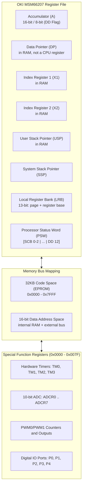

# Honda P28 OBD1 ECU Architecture Notes

This document separates MSM66207 facts from stock-P28 ROM and board
observations. It is not a specification for every Honda OBD1 ECU or proof of
physical ECU behavior.

---

## 📌 Microcontroller Architecture (OKI MSM66207)

### CPU Specifications
- **Architecture**: OKI MSM66207 16-bit Microcontroller
- **Clock Model**: 10 MHz oscillator and 5 MHz machine-cycle rate. Instructions
  consume the manual's internal-memory machine-cycle counts; this is not 5 MIPS.
- **Data Bus**: 16-bit internal architecture
- **PSW Status Word** (per the OKI MSM66201 Instruction Manual):
  - `SCB` (Bits 0–2): **System Control Base** — selects which pointing-register
    set `PR0..PR7` is live. `X1`, `X2`, `DP` and `USP` are *not* CPU registers:
    they live in RAM at `0x0080 + SCB*8`.
  - Bits 3, 6, 7, 10, and 11: unimplemented, **read as 1**.
  - `DD` (Bit **12**): Word/Byte mode (`DD = 1`: 16-bit; `DD = 0`: 8-bit).
    Also gates instruction *decoding* — `0x18` is `ADC A, er0` under DD=1 but
    `ADCB A, r0` under DD=0.
  - `CF` (bit 15), `ZF` (14), `HC` (13), and `DD` (12) are documented flag
    positions. `CF = 1` represents borrow/less-than for subtraction/compare.
  - `MIE` (bit 8) globally enables maskable interrupts; the `IE` SFR provides
    the per-source mask. Interrupt entry clears MIE and `RTI` restores it.

> ⚠️ Earlier revisions of this document listed PSW as `[ZF|CF|HC|DD|IE]` in bits
> 0–7 and treated `X1/X2/DP/USP` as CPU registers. Both were wrong. See
> [`docs/CPU_CORE.md`](CPU_CORE.md) for the corrected model and its evidence.

---

## 🗺️ Memory Map & Addressing

| Address Range | Memory Type | Function / Content |
|---|---|---|
| `0x0000` – `0x007F` | **SFR Space** | Special Function Registers (Timers, ADC, PWM, I/O Ports) |
| `0x0080` – `0x00BF` | **Pointing Registers** | 8 sets `PR0..PR7`, each `X1, X2, DP, USP`; the live set is chosen by PSW `SCB` |
| `0x00C0` – `0x047F` | **On-chip Data RAM** | Internal transient state and learned trims |
| `0x0480` – `0xFFFF` | **External Data Space** | Architectural external bus; the emulator currently has a 4 KiB backing array and aliases higher addresses |
| `0x0000` – `0x7FFF` | **Code ROM** | 32KB External EPROM (Machine code instructions, Fuel & Ignition 3D Lookup Tables) |

---

## P28 Analog Front End

Bomarc sheet 3 shows two CD4051 muxes sharing `P2.5=A`, `P2.6=B`, and
`P2.7=C`. U6 common feeds `P5.0/AI0/ADCR0`; U5 common feeds
`P5.1/AI1/ADCR1`.

| path | select | confirmed signal |
|---|---:|---|
| U6 → ADCR0 | 0 | conditioned primary HEGO |
| U6 → ADCR0 | 3 | on-board barometric sensor |
| U5 → ADCR1 | 0 | ELD |
| U5 → ADCR1 | 2 | ECT |
| U5 → ADCR1 | 3 | boot-check input; external semantics unresolved |
| direct AI3 | — | optional EGR position |
| direct AI6 | — | MAP |
| direct AI7 | — | TPS |

The scenario model has an IAT field, but its P28 mux/ADC endpoint remains
unresolved and is not currently driven into an asserted hardware channel.

At `0x52DE..0x52F7`, the stock ROM derives the selector from `P2 >> 5`, stores
ADCR0H at `0x03BE[index]` and ADCR1H at `0x03C6[index]`, and advances the shared
selector by `0x20`. Conversion completion samples the selected mux inputs while
the preceding ADCR values remain latched. The modeled 64 us conversion is 320
machine cycles at 5 MHz, equivalent to 640 clocks of the 10 MHz oscillator.

### Boot-latch trace: `0x0320` is not the source

The cold-boot trace shows `0x0320` being cleared at `0x2403`; code at
`0x241D..0x2423` then only applies `0x0320 &= 0xF0`. It is later DTC/status
state, not a pre-mux configuration source.

The saved bit at `0x9F.0` comes from external DATA[`0x4700`].0 instead:
`0x220E` selects `0x4700`, `0x2211` reads it, `0x2212` shifts bit 0 into carry,
and `0x2213` stores carry into `0x9F.0`; `0x2426` restores it after RAM clear.
The emulator currently aliases `0x4700` to its 4 KiB backing store at `0x0700`.
That external digital-input buffer is a separate unresolved board model, not
part of the analog mux and not a value that should be invented at `0x0320`.

---

## Crank-angle inputs

Derived from the stock ROM; not yet confirmed against the schematic.

| signal | rate | MCU input | ROM consumer |
|---|---|---|---|
| CKP | 24 / cam rev | P3.6 / TM2IO (timer-2 capture, IRQ 9) | `0x014D`, then software IRQ 3 → `0x03DC`; tooth counter RAM `0x12A` = 0..23 |
| TDC | 4 / cam rev | P3.3 / INT1 (IRQ 15) | polled as `IRQH.7`; vectored at `0x037B` only in the TDC-only fallback |
| CYP | 1 / cam rev | P4.4 / TRNS0 | polled as `TRNSIT.0`; re-zeroes the tooth counter |
| VSS | vehicle speed | P3.2 / INT0 (IRQ 0) | `0x01D3`, period capture against TM2 |

The ROM has two crank modes, selected by the supervisor at `0x37BC` and visible
in the IE shadow at RAM `0xF2`:

| IE shadow | mode | entered when |
|---|---|---|
| `0x2BAB` | normal: CKP teeth through the timer-2 event and IRQ 3 | CKP activity counter `0x1A9` is being reloaded |
| `0xA9A3` | fallback: INT1 (TDC) only | `0x1A9` runs down, or fault bit `0x212.3` is set |

## Injector output stage

P2.0–P2.3 are staged data, active low. A rising edge of timer 0's realtime
output (`TROUT`, pin TM0IO / P3.4) clocks them to the injector drivers. The ROM
makes that edge by hand to open an injector or cut fuel, and lets the timer-0
compare match make it to close an injector at an exact time. Widths are in
3.2 µs timer-0 counts; a width below `0xC0` is treated as no fuel. Details and
addresses are in [`INJECTION.md`](INJECTION.md).

---

## ⚡ Interrupt Vector Table

| Vector Address | Priority | Trigger Source | ECU Function |
|---|---|---|---|
| `0x0000` | — | Reset | Reset-handler address |
| `0x0002` | — | BRK | Software-break handler address |
| `0x0004` | — | Watchdog/opcode trap | Trap-handler address |
| `0x0006` | — | NMI | Non-maskable-interrupt handler address |
| `0x0008 + 2n` | IRQ bit `n` | IRQ/IE sources 0–15 | Sixteen handler words through `0x0026` |

For P28-230, IRQ bit 0 points to handler `0x01D3` and bit 1 points to handler
`0x01FD`. Those are targets stored in the vector table, not architectural
vector addresses themselves. CYP is polled through transition-detector status
`TRNS.0`; it is not represented as a second generic external interrupt.

Stock P28-230 handlers:

| IRQ bit | source | handler | P28 use |
|---|---|---|---|
| 0 | INT0 | `0x01D3` | speed-signal period |
| 1 | serial receive | `0x01FD` | |
| 3 | serial transmit / BRG | `0x03DC` | requested by software at `0x7674`: per-tooth crank-angle work |
| 5 | TM0 event | `0x0086` | injector close queue |
| 7 | TM1 event | `0x0114` | |
| 8 | TM2 overflow | `0x02DD` | period-measurement extension |
| 9 | TM2 event | `0x014D` | CKP tooth (capture) |
| 11 | TM3 event | `0x02FB` | |
| 13 | PWM | `0x031E` | |
| 15 | INT1 | `0x037B` | TDC, fallback mode only |

Unlisted bits point at the common stub `0x21CB`.

---

## 🧮 Conceptual ECU Calculations

The formulas below show plausible dependencies, not decoded P28 equations,
table dimensions, constants, units, or validation assertions.

### 1. Fuel Injector Pulse Width Formula ($T_{inj}$)

The ECU calculates total fuel injection duration per pulse using the following equation:

$$T_{inj} = \left( T_{base}(\text{RPM}, \text{MAP}) \times K_{ect}(T_{ect}) \times K_{iat}(T_{iat}) \times K_{accel}\left(\frac{d\text{TPS}}{dt}\right) \times K_{\lambda} \right) + T_{dead}(V_{batt})$$

Where:
- $T_{base}(\text{RPM}, \text{MAP})$: Candidate base-fuel lookup dependency.
- $K_{ect}(T_{ect})$: Candidate coolant-temperature correction.
- $K_{iat}(T_{iat})$: Air density temp correction multiplier.
- $K_{accel}$: Transient acceleration tip-in enrichment multiplier.
- $K_{\lambda}$: Closed-loop O2 sensor feedback correction trim.
- $T_{dead}(V_{batt})$: Candidate battery-voltage dead-time correction.

### 2. Ignition Advance Calculation ($\theta_{spark}$)

$$\theta_{spark} = \theta_{base}(\text{RPM}, \text{MAP}) + \theta_{ect} + \theta_{iat} - \theta_{knock}$$

The emulator does not yet assert the selected table, interpolation method, or
units.

---

## 🏎️ VTEC Spool Valve & Pressure Switch Hysteresis

RPM, TPS, coolant temperature, vehicle speed, and pressure-switch feedback are
candidate VTEC dependencies used by scenario traces. Exact thresholds,
hysteresis, DTC qualification, and output wiring must be derived from the ROM
and board schematic. The current `vtec_active` field is emulator-side logic,
not proof of a stock-ROM output.

---

## 🚦 Diagnostic Trouble Code (DTC) Pipeline

The project contains Honda OBD1 DTC reference metadata and selected synthetic
stimuli/evaluators. It does not decode the stock ROM's complete DTC storage,
qualification timers, or failsafe decisions. Analog voltage thresholds also do
not apply generically to digital switches and solenoids.

## Known Fidelity Limits

- The P28 board outputs other than the injectors remain unresolved,
  including the loads on the PWM pins.
- The external digital-input buffer at `0x4700` is not modeled.
- The injector output stage and crank-signal pin assignment are ROM-derived
  and await confirmation against the schematic; cylinder mapping and sensor
  phasing are not established.
- Stock-ROM tests require an external image; decoder ground truth is tracked,
  but mnemonic/length agreement does not certify execution or hardware.
- TCP datalog compatibility and scenario/DTC conclusions remain experimental.
